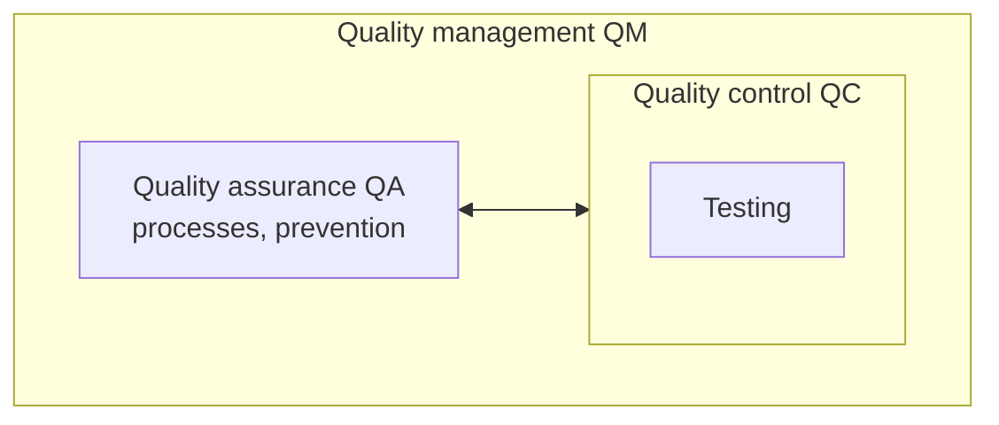
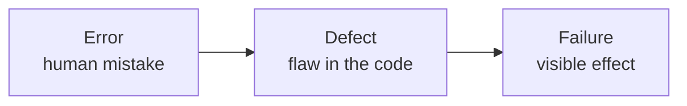

# QA fundamentals

The key concepts of quality assurance and software testing, largely based on the **ISTQB CTFL v4.0** syllabus.

## QM, QA and QC

**QM (Quality Management)**
:   An organisation's quality management system covering quality policy, quality objectives, processes, supervision and continuous improvement, to ensure that products or services meet customer requirements and standards. It includes QA and QC.

**QA (Quality Assurance)**
:   Activities that ensure quality by creating and supervising processes, procedures and standards meant to prevent defects.

**QC (Quality Control)**
:   Activities that check and evaluate the quality of a product, service, component or system.

According to ISTQB, quality management (QM) covers both QA (process-oriented, preventive) and QC (product-oriented, including testing). The two complement each other and in practice often work as separate areas in an organisation.

## Testing

### What is testing?

**Testing** is a set of activities to discover defects and evaluate the quality of software and related work products (requirements, design, code). It covers both running the system (dynamic testing) and reviews without running it (static testing).

| | Testing | Debugging |
|---|---|---|
| **Goal** | finding out that something does not work correctly | finding the cause of a defect and fixing it |
| **Who** | mainly the tester | mainly the developer |
| **How** | running tests and comparing expected and actual results | analysing the code after receiving a defect report |

### Objectives of testing

Typical test objectives according to the CTFL v4.0 syllabus:

- evaluating work products such as requirements, user stories, designs and code,
- triggering failures and finding defects,
- ensuring the required coverage of a test object,
- reducing the level of risk of inadequate software quality,
- verifying whether specified requirements have been fulfilled,
- verifying that a test object complies with contractual, legal and regulatory requirements,
- providing information to stakeholders to allow them to make informed decisions,
- building confidence in the quality of the test object,
- validating whether the test object is complete and works as expected by the stakeholders.

Objectives depend on the context: component testing has different objectives from acceptance testing.

### Error, defect and failure

| Term | Description |
|---|---|
| **Error** | a human mistake that leads to a defect |
| **Defect (bug)** | a flaw in the code or another work product |
| **Failure** | the effect of a defect at runtime: a component or system does not perform a required function |

### Seven testing principles

1. Testing shows the presence of defects, not their absence.
2. Exhaustive testing is impossible.
3. Early testing saves time and money.
4. Defects cluster together in certain areas of the system.
5. Tests wear out (pesticide paradox): the same tests stop finding new defects, so they need regular updates.
6. Testing is context dependent (e.g. testing medical systems differs from testing games).
7. Absence-of-defects fallacy: a system without defects may still not meet users' needs.

### Verification vs validation

| | Question | Checks |
|---|---|---|
| **Verification** | *Are we building the product right?* | compliance with the specification |
| **Validation** | *Are we building the right product?* | meeting the user's needs |

## Software development lifecycle

### Selected models

**Sequential**: development activities are performed linearly, and the next phase starts when the previous one ends.

- **Waterfall**: testing starts when all other development activities are finished. Used for products with detailed documentation and well-defined requirements that rarely change.
- **V-model**: unlike waterfall, it introduces early testing. Each development stage has a corresponding test level.

**Iterative and incremental**: software is built in short cycles, and every cycle adds features.

- **Scrum**: one of the most popular frameworks. It splits development into short iterations (sprints) of fixed length. Testing happens in every sprint, alongside development. Changes are frequent, so teams automate a large share of regression tests and add exploratory testing of new features.
- **Kanban**: no fixed iterations. Work is organised on a board with task cards and work-in-progress (WIP) limits. Features go to production when they are ready. The focus is on smooth flow, spotting bottlenecks quickly and reacting flexibly to changing priorities.
- **Boehm's spiral model**: called the model of models, because any other model can be derived from it. Every iteration starts with a risk analysis. It produces prototypes that may be rebuilt or even abandoned.
- **RUP**: an iterative model based on phases and use cases, tailored to the needs of the project.

### Shift left

**Shift left** means moving testing to earlier stages of development to find and remove defects sooner and lower the cost of fixing them.

### Test-driven approaches

| Approach | Description |
|---|---|
| **TDD (Test-Driven Development)** | first a unit test, then the code that makes it pass. Cycle: test → implementation → refactoring |
| **ATDD (Acceptance Test-Driven Development)** | acceptance tests defined from acceptance criteria before implementation |
| **BDD (Behavior-Driven Development)** | system behaviour described in natural language, often with Given / When / Then syntax (Gherkin) |

### DevOps and CI/CD

**DevOps** combines software development (Development) and system operations (Operations) to improve collaboration, automate processes and deliver high-quality applications faster.

- collaboration between developers, testers and administrators,
- automated building, testing and deployment,
- continuous monitoring of applications and infrastructure,
- finding and fixing defects quickly thanks to CI/CD.

| Term | Meaning |
|---|---|
| **CI (Continuous Integration)** | continuous code integration and automated tests |
| **CD (Continuous Delivery)** | the application is always ready to be deployed |
| **Continuous Deployment** | changes are deployed to production automatically |

In practice: [Jenkins](../tools/ci_cd/jenkins.md), [GitHub Actions](../tools/ci_cd/github_actions.md).

### Retrospective

A **retrospective** is a team meeting after an iteration or project stage. The team discusses what went well, what needs improvement and how to improve further work, including the test process. In Scrum it usually takes place after every sprint.

## Test process

| Activity | Outcome |
|---|---|
| **Test planning** | test plan: objectives, approach, techniques, schedule |
| **Test monitoring and control** | progress reports, decisions on corrective actions |
| **Test analysis** | test conditions based on specifications, diagrams and requirements |
| **Test design** | test cases and test suites |
| **Test implementation** | ready test suites, test data, environment |
| **Test execution** | test results, defect reports |
| **Test completion** | test completion report, archived testware, lessons learned |

Planning and criteria in detail: [Test management](test_management.md).

## Test levels

| Level | What it checks |
|---|---|
| **Unit (component) testing** | small pieces of code, done mainly by developers |
| **Integration testing** | interaction between components (component integration testing) or between systems (system integration testing) |
| **System testing** | the whole application as a whole |
| **Acceptance testing** | whether the system meets the needs of users, the customer and business requirements |

Types of acceptance testing:

- **UAT (User Acceptance Testing)**: done by end users, checks real usage scenarios.
- **OAT (Operational Acceptance Testing)**: done by administrators or operators, focuses on operating the system, e.g. security, backups, disaster recovery.
- **Compliance testing**: checks compliance with contracts, standards or regulations.
- **Alpha**: in the producer's environment, by testers, potential customers or an independent team.
- **Beta**: by users or customers in their own environment, outside the producer's premises.

## Test types

| Criterion | Types |
|---|---|
| **Code execution** | **static** (no execution: reviews of specifications, architecture, code) / **dynamic** (with a running component or system) |
| **Purpose** | **functional** (what the system does) / **non-functional** (how it works: performance, security, usability) |
| **Test basis** | **black-box** (specification) / **white-box** (code structure) / **experience-based** |
| **Execution** | **manual** (exploration, UX, validation) / **automated** (regression, repeatable tests) |

Change-related testing:

- **Confirmation testing (retesting)**: done after a defect is fixed, checks that the defect has really been removed.
- **Regression testing**: checks that a change has not broken existing features. Often automated.

Other commonly used names:

- **Smoke tests**: a quick check of a new build or deployment that the application starts and its main features work. If not, further testing makes no sense.
- **Sanity tests**: a narrow, quick check of the area a change touched and the features closest to it. It is a shallow regression test, not a retest of a specific defect.
- **Exploratory testing**: the tester learns the application, designs and runs tests at the same time, guided by the goal of the session (a test charter). See [Test techniques](test_techniques.md#exploratory-testing).

**Maintenance testing** concerns software already in production use. Its triggers are:

- **modifications**: fixes, new features, configuration changes, library upgrades,
- **migration**: moving to another platform or environment, data conversion,
- **retirement**: archiving, restoring and deleting data.

The scope is set by **impact analysis**: which parts of the system a change may affect and how much regression testing is needed.

Test design techniques and statement and branch coverage are described on the [Test techniques](test_techniques.md) page.

## Reviews

### Review process

1. Planning
2. Review initiation
3. Individual review
4. Communication and analysis of issues
5. Fixing and reporting

### Review types

| Type | Formality | Characteristics |
|---|---|---|
| **Informal review** | lowest | quickly finding problems and exchanging ideas, common in agile teams |
| **Walkthrough** | low to high | the author presents the material to the team, goal: defects, improvements, shared understanding. A scribe is mandatory |
| **Technical review** | high | technical experts assess quality and look for solutions. Individual preparation is mandatory, usually ends with a report |
| **Inspection** | highest | defined roles and procedures, all roles are mandatory and cannot be combined, the report is used for future improvement |

### Roles in a formal review

Author, management, facilitator (moderator), review leader, reviewers, scribe.

## Documentation and defects

Test cases, defect reports and the test plan are described on the [Test documentation](test_documentation.md) page. The defect lifecycle, from **New** to **Closed**, including the **Rejected**, **Duplicate** and **Deferred** statuses, is described in [Test management](test_management.md#defect-management).

### Requirements specification

A **requirements specification** is a document containing all functional and non-functional expectations of the system. SRS and BRS differ but are related:

- **SRS (Software Requirements Specification)**: software requirements,
- **BRS (Business Requirements Specification)**: business requirements.

??? abstract "Typical contents of a specification"

    - product name
    - authors
    - document version and change history
    - table of contents
    - company profile
    - description of the future or current system
    - glossary
    - functional and non-functional requirements
    - list of requirements with priorities and use cases
    - system model

## Planning and estimation

### Estimation techniques

| Technique | How it works |
|---|---|
| **Estimation based on ratios** | uses ratios from previous projects, e.g. test effort to development effort |
| **Extrapolation** | measurements from early in the current project (e.g. the first sprints) are used to predict the remaining effort |
| **Wideband Delphi** | experts estimate independently, discuss the differences and repeat until they agree. **Planning Poker** is a variant |
| **Three-point estimation** | described below |

### Three-point estimation

A technique for estimating the duration of testing or a task based on three values:

- **O (Optimistic)**: the optimistic case, when everything goes smoothly,
- **M (Most likely)**: the most likely case,
- **P (Pessimistic)**: the pessimistic case, when problems or delays occur.

**E = (O + 4M + P) / 6**

!!! example "Example"
    O = 4 h, M = 6 h, P = 14 h, so E = (4 + 24 + 14) / 6 = **7 h**.

### Testing quadrants

The **testing quadrants** are a model that helps agile teams plan and organise test activities. They group tests along two axes: **business-facing** or **technology-facing**, and whether they **support the team** during development or **critique the product** by looking for its weaknesses.

| | Support the team | Critique the product |
|---|---|---|
| **Business-facing** | **Q2**: functional tests, examples, user story tests, UX prototypes, API testing, simulations. Manual and automated | **Q3**: exploratory testing, usability testing, user acceptance testing (UAT). User-oriented, often manual |
| **Technology-facing** | **Q1**: component tests and component integration tests. Automated, often in CI | **Q4**: smoke tests and non-functional tests (except usability), e.g. performance and security. Often automated, with tools |

## Other important terms

| Term | Description |
|---|---|
| **Traceability matrix (RTM)** | links between requirements and test cases |
| **Test pyramid** | test proportions: most fast component tests, fewer integration tests, fewest slow UI tests. More in [test automation strategy](test_automation_strategy.md) |
| **Exit criteria** | conditions for finishing testing, e.g. required coverage of high-risk requirements reached, no open critical defects, acceptable residual risk. Running out of budget or time also ends testing, but then stakeholders knowingly accept the remaining risk |
| **Risk** | a factor that could result in future negative consequences ([Test management](test_management.md#risk-and-testing)) |
