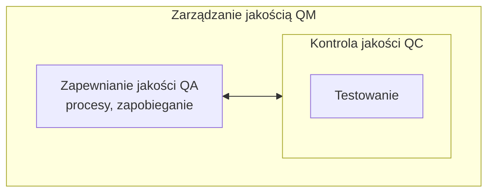
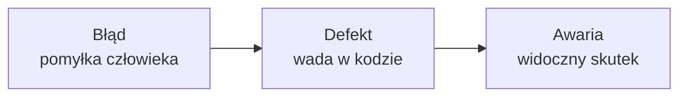

# Podstawy QA

Najważniejsze pojęcia z zakresu zapewniania jakości i testowania oprogramowania, w dużej mierze na podstawie sylabusa **ISTQB CTFL v4.0**.

## QM, QA i QC

**QM (Quality Management)**
:   System zarządzania jakością w organizacji obejmujący politykę jakości, cele jakościowe, procesy, nadzór oraz ciągłe doskonalenie, w celu zapewnienia zgodności produktów lub usług z wymaganiami klienta i normami. Obejmuje QA i QC.

**QA (Quality Assurance)**
:   Działania związane z zapewnieniem jakości poprzez tworzenie i nadzorowanie procesów, procedur oraz standardów, które mają zapobiegać powstawaniu błędów.

**QC (Quality Control)**
:   Działania związane z kontrolą i oceną jakości produktu, usługi, modułu lub systemu.

Według ISTQB zarządzanie jakością (QM) obejmuje zarówno QA (nastawione na procesy i zapobieganie), jak i QC (nastawione na produkt, w tym testowanie). Obie grupy działań się uzupełniają, a w praktyce organizacyjnej często funkcjonują jako osobne obszary.

## Testowanie

### Czym jest testowanie?

**Testowanie** to zbiór czynności, które pozwalają wykrywać defekty i oceniać jakość oprogramowania oraz powiązanych produktów pracy (wymagań, projektu, kodu). Obejmuje zarówno uruchamianie systemu (testowanie dynamiczne), jak i przeglądy bez uruchamiania (testowanie statyczne).

| | Testowanie | Debugowanie |
|---|---|---|
| **Cel** | wykrycie, że coś działa niepoprawnie | znalezienie przyczyny błędu i jego naprawa |
| **Kto** | głównie tester | głównie programista |
| **Jak** | uruchamianie testów i porównywanie wyniku oczekiwanego z rzeczywistym | analiza kodu po otrzymaniu raportu o defekcie |

### Cele testowania

Typowe cele testowania wg sylabusa CTFL v4.0:

- ocena produktów pracy, takich jak wymagania, historyjki użytkownika, projekt i kod,
- wywoływanie awarii i wykrywanie defektów,
- zapewnienie wymaganego pokrycia przedmiotu testów,
- obniżenie poziomu ryzyka niedostatecznej jakości oprogramowania,
- sprawdzenie, czy zostały spełnione określone wymagania,
- sprawdzenie, czy przedmiot testów jest zgodny z wymaganiami umów, przepisów prawa i norm,
- dostarczenie interesariuszom informacji pozwalających podejmować świadome decyzje,
- budowanie zaufania do jakości przedmiotu testów,
- walidacja, czy przedmiot testów jest kompletny i działa tak, jak oczekują interesariusze.

Cele zależą od kontekstu: innych oczekuje się od testów modułowych, a innych od testów akceptacyjnych.

### Błąd, defekt i awaria

| Pojęcie | Opis |
|---|---|
| **Błąd (error)** | pomyłka człowieka prowadząca do powstania defektu |
| **Defekt (defect, bug)** | nieprawidłowość w kodzie lub innym produkcie pracy |
| **Awaria (failure)** | skutek defektu w czasie działania: moduł lub system nie wykonuje wymaganej funkcji |

### Siedem zasad testowania

1. Testowanie ujawnia obecność defektów, nie ich brak.
2. Testowanie gruntowne (wszystkiego) jest niemożliwe.
3. Wczesne testowanie oszczędza czas i pieniądze.
4. Defekty mają tendencję do kumulowania się w określonych obszarach systemu.
5. Testy się zużywają (paradoks pestycydów): te same testy przestają wykrywać nowe defekty, dlatego trzeba je regularnie aktualizować.
6. Testowanie zależy od kontekstu (np. testy systemów medycznych różnią się od testów gier).
7. Przekonanie o braku defektów jest błędem: system bez defektów nadal może nie spełniać potrzeb użytkowników.

### Weryfikacja a walidacja

| | Pytanie | Sprawdza |
|---|---|---|
| **Weryfikacja (verification)** | *Czy budujemy produkt dobrze?* | zgodność ze specyfikacją |
| **Walidacja (validation)** | *Czy budujemy dobry produkt?* | spełnienie potrzeb użytkownika |

## Cykl życia oprogramowania

### Wybrane modele

**Sekwencyjne**: kolejne czynności wytwórcze wykonuje się liniowo, a następna faza zaczyna się po zakończeniu poprzedniej.

- **Kaskadowy (waterfall)**: czynności testowe zaczynają się, gdy wszystkie inne czynności wytwórcze zostaną ukończone. Model stosuje się dla produktów z dokładną dokumentacją i dobrze zdefiniowanymi wymaganiami, które rzadko się zmieniają.
- **Model V**: w przeciwieństwie do kaskadowego wprowadza zasadę wczesnego testowania. Każdemu etapowi wytwarzania odpowiada powiązany poziom testów.

**Iteracyjno-przyrostowe**: oprogramowanie powstaje w krótkich cyklach, a z każdym cyklem przybywa funkcji.

- **Scrum**: jedna z najpopularniejszych metodyk. Dzieli wytwarzanie na krótkie iteracje (sprinty) o stałej długości. Testowanie odbywa się w każdym sprincie, razem z wytwarzaniem. Zmiany są częste, dlatego zespoły automatyzują dużą część testów regresji i uzupełniają je testowaniem eksploracyjnym nowych funkcji.
- **Kanban**: nie narzuca stałych iteracji. Pracę organizuje się na tablicy z kartami zadań i limitami pracy w toku (WIP). Funkcjonalności trafiają na produkcję, gdy są gotowe. Nacisk kładzie się na płynny przepływ, szybkie wykrywanie wąskich gardeł i elastyczną zmianę priorytetów.
- **Model spiralny Boehma**: nazywany modelem modeli, bo można z niego uzyskać każdy inny model. Każda iteracja zaczyna się od analizy ryzyka. Powstają w nim prototypy, które można przebudować, a nawet porzucić.
- **RUP**: iteracyjny model oparty na fazach i przypadkach użycia, dostosowywany do potrzeb projektu.

### Shift Left

**Shift Left** to przesunięcie testowania na wcześniejsze etapy wytwarzania oprogramowania, aby szybciej wykrywać i usuwać defekty oraz obniżyć koszty ich naprawy.

### Podejścia sterowane testami

| Podejście | Opis |
|---|---|
| **TDD (Test-Driven Development)** | najpierw test jednostkowy, potem kod, który go spełnia. Cykl: test → implementacja → refaktoryzacja |
| **ATDD (Acceptance Test-Driven Development)** | testy akceptacyjne definiowane na podstawie kryteriów akceptacji przed implementacją |
| **BDD (Behavior-Driven Development)** | opis zachowania systemu w języku naturalnym, często w składni Given / When / Then (Gherkin) |

### DevOps i CI/CD

**DevOps** łączy wytwarzanie oprogramowania (Development) z utrzymaniem systemów (Operations), aby usprawnić współpracę, zautomatyzować procesy i szybciej dostarczać aplikacje wysokiej jakości.

- współpraca programistów, testerów i administratorów,
- automatyzacja budowania, testowania i wdrażania,
- ciągłe monitorowanie aplikacji i infrastruktury,
- szybkie wykrywanie i naprawianie defektów dzięki CI/CD.

| Pojęcie | Znaczenie |
|---|---|
| **CI (Continuous Integration)** | ciągła integracja kodu i automatyczne testy |
| **CD (Continuous Delivery)** | aplikacja zawsze gotowa do wdrożenia |
| **Continuous Deployment** | automatyczne wdrażanie zmian na produkcję |

W praktyce: [Jenkins](../tools/ci_cd/jenkins.md), [GitHub Actions](../tools/ci_cd/github_actions.md).

### Retrospektywa

**Retrospektywa** to spotkanie zespołu po zakończeniu iteracji lub etapu projektu. Omawia się na nim, co poszło dobrze, co wymaga poprawy i jak usprawnić dalszą pracę, w tym proces testowania. W Scrumie odbywa się zwykle po każdym sprincie.

## Proces testowy

| Czynność | Rezultat |
|---|---|
| **Planowanie testów** | plan testów: cele, podejście, techniki, harmonogram |
| **Monitorowanie i nadzór** | raporty z postępu, decyzje o działaniach korygujących |
| **Analiza testów** | warunki testowe na podstawie specyfikacji, diagramów i wymagań |
| **Projektowanie testów** | przypadki testowe i zestawy testów |
| **Implementacja testów** | gotowe zestawy testowe, dane testowe, środowisko |
| **Wykonywanie testów** | wyniki testów, raporty o defektach |
| **Ukończenie testów** | raport końcowy, archiwizacja testaliów, wnioski na przyszłość |

Szczegóły planowania i kryteriów: [Zarządzanie testami](test_management.md).

## Poziomy testów

| Poziom | Co sprawdza |
|---|---|
| **Testy jednostkowe (modułowe)** | małe fragmenty kodu, wykonywane głównie przez programistów |
| **Testy integracyjne** | współpracę między modułami (testy integracji modułów) lub między systemami (testy integracji systemów) |
| **Testy systemowe** | całą aplikację jako całość |
| **Testy akceptacyjne** | czy system spełnia potrzeby użytkowników, klienta i wymagania biznesowe |

Rodzaje testów akceptacyjnych:

- **UAT (User Acceptance Testing)**: wykonywane przez użytkowników końcowych, sprawdzają rzeczywiste scenariusze użycia.
- **OAT (Operational Acceptance Testing)**: wykonywane przez administratorów lub operatorów, dotyczą utrzymania systemu, np. bezpieczeństwa, kopii zapasowych, odtwarzania po awarii.
- **Testy zgodności**: sprawdzają zgodność z umowami, normami lub przepisami prawa.
- **Alfa**: w środowisku producenta, przez testerów, potencjalnych klientów lub niezależny zespół.
- **Beta**: przez użytkowników lub klientów w ich własnym środowisku, poza siedzibą producenta.

## Typy testów

| Kryterium | Typy |
|---|---|
| **Uruchamianie kodu** | **statyczne** (bez uruchamiania: przeglądy specyfikacji, architektury, kodu) / **dynamiczne** (z uruchomionym modułem lub systemem) |
| **Cel** | **funkcjonalne** (co system robi) / **niefunkcjonalne** (jak działa: wydajność, bezpieczeństwo, użyteczność) |
| **Podstawa testów** | **czarnoskrzynkowe** (specyfikacja) / **białoskrzynkowe** (struktura kodu) / **oparte na doświadczeniu** |
| **Sposób wykonania** | **manualne** (eksploracja, UX, walidacja) / **automatyczne** (regresja, testy powtarzalne) |

Testy związane ze zmianami:

- **Testowanie potwierdzające (retesty)**: wykonywane po naprawie defektu, sprawdza, czy defekt został rzeczywiście usunięty.
- **Testowanie regresji**: sprawdza, czy zmiana nie zepsuła istniejących funkcji. Często jest automatyzowane.

Inne często używane nazwy:

- **Smoke testy**: szybkie sprawdzenie nowego buildu lub wdrożenia, czy aplikacja się uruchamia i działają jej główne funkcje. Jeśli nie, dalsze testy nie mają sensu.
- **Sanity testy**: wąskie, szybkie sprawdzenie obszaru, którego dotyczyła zmiana, i najbliższych funkcji. To powierzchowny test regresji, a nie retest konkretnego defektu.
- **Testowanie eksploracyjne**: tester jednocześnie poznaje aplikację, projektuje i wykonuje testy, kierując się celem sesji (karta testu). Opis w [Technikach testowania](test_techniques.md#testowanie-eksploracyjne).

**Testowanie pielęgnacyjne** dotyczy oprogramowania już używanego na produkcji. Wyzwalaczami są:

- **modyfikacje**: poprawki, nowe funkcje, zmiany konfiguracji, aktualizacje bibliotek,
- **migracja**: przeniesienie na inną platformę lub środowisko, konwersja danych,
- **wycofanie z użytku**: archiwizacja danych, ich odtwarzanie i usunięcie.

Zakres testów wyznacza **analiza wpływu**: które części systemu mogą zostać dotknięte zmianą i ile testów regresji trzeba wykonać.

Techniki projektowania testów i pokrycie instrukcji oraz gałęzi opisuje strona [Techniki testowania](test_techniques.md).

## Przeglądy

### Proces przeglądu

1. Planowanie
2. Rozpoczęcie przeglądu
3. Przegląd indywidualny
4. Przekazanie informacji o problemach i ich analiza
5. Usunięcie defektów i raportowanie

### Typy przeglądów

| Typ | Formalność | Charakterystyka |
|---|---|---|
| **Przegląd nieformalny** | najniższa | szybkie wykrywanie problemów i wymiana pomysłów, częsty w zespołach zwinnych |
| **Przejrzenie (walkthrough)** | niska do wysokiej | autor prezentuje materiał zespołowi, cel: defekty, usprawnienia, wspólne zrozumienie. Protokolant obowiązkowy |
| **Przegląd techniczny** | wysoka | eksperci techniczni oceniają jakość i szukają rozwiązań. Obowiązkowe przygotowanie indywidualne, zwykle raport |
| **Inspekcja** | najwyższa | ustalone role i procedury, wszystkie role obowiązkowe i nie można ich łączyć, raport służy przyszłym usprawnieniom |

### Role w przeglądzie formalnym

Autor, kierownictwo, facylitator (moderator), lider przeglądu, przeglądający, protokolant.

## Dokumentacja i defekty

Przypadek testowy, raport o defekcie i plan testów opisuje strona [Dokumentacja testowa](test_documentation.md). Cykl życia defektu, od **New** do **Closed**, razem ze statusami **Rejected**, **Duplicate** i **Deferred**, opisuje [Zarządzanie testami](test_management.md#zarzadzanie-defektami).

### Specyfikacja wymagań

**Specyfikacja wymagań** to dokument zawierający wszystkie funkcjonalne i niefunkcjonalne oczekiwania wobec systemu. SRS i BRS różnią się, ale są ze sobą powiązane:

- **SRS (Software Requirements Specification)**: specyfikacja wymagań oprogramowania,
- **BRS (Business Requirements Specification)**: specyfikacja wymagań biznesowych.

??? abstract "Typowa zawartość specyfikacji"

    - nazwa produktu
    - autorzy
    - wersja dokumentu i historia zmian
    - spis treści
    - charakterystyka firmy
    - opis przyszłego lub aktualnego systemu
    - słownik pojęć
    - wymagania funkcjonalne i niefunkcjonalne
    - lista wymagań z priorytetami i przypadkami użycia
    - model systemu

## Planowanie i szacowanie

### Techniki szacowania

| Technika | Na czym polega |
|---|---|
| **Na podstawie współczynników** | wykorzystuje proporcje z poprzednich projektów, np. stosunek nakładu na testy do nakładu na wytwarzanie |
| **Ekstrapolacja** | na podstawie pomiarów z początku bieżącego projektu (np. z pierwszych sprintów) przewiduje się dalszy nakład |
| **Wideband Delphi** | eksperci szacują niezależnie, omawiają rozbieżności i powtarzają szacowanie aż do porozumienia. Odmianą jest **Planning Poker** |
| **Szacowanie trzypunktowe** | opisane niżej |

### Szacowanie trzypunktowe

Technika szacowania czasu wykonania testów lub zadania na podstawie trzech wartości:

- **O (Optimistic)**: wariant optymistyczny, gdy wszystko idzie bez problemów,
- **M (Most likely)**: wariant najbardziej prawdopodobny,
- **P (Pessimistic)**: wariant pesymistyczny, gdy pojawiają się problemy lub opóźnienia.

**E = (O + 4M + P) / 6**

!!! example "Przykład"
    O = 4 h, M = 6 h, P = 14 h, więc E = (4 + 24 + 14) / 6 = **7 h**.

### Kwadranty testowe

**Kwadranty testowe** to model, który pomaga planować i organizować działania testowe w zespołach zwinnych. Dzieli testy według dwóch osi: czy są **zorientowane na biznes**, czy **na technologię**, oraz czy **wspierają zespół** w wytwarzaniu, czy **krytykują produkt**, szukając w nim słabych punktów.

| | Wspierają zespół | Krytykują produkt |
|---|---|---|
| **Zorientowane na biznes** | **Q2**: testy funkcjonalne, przykłady, testy historyjek użytkownika, prototypy UX, testy API, symulacje. Manualne i automatyczne | **Q3**: testowanie eksploracyjne, testy użyteczności, testy akceptacyjne użytkownika (UAT). Zorientowane na użytkownika, często manualne |
| **Zorientowane na technologię** | **Q1**: testy modułowe i testy integracji modułów. Automatyczne, często w CI | **Q4**: smoke testy i testy niefunkcjonalne (poza użytecznością), np. wydajności i bezpieczeństwa. Często automatyczne, z użyciem narzędzi |

## Inne ważne pojęcia

| Pojęcie | Opis |
|---|---|
| **Macierz śledzenia (RTM)** | powiązania między wymaganiami a przypadkami testowymi |
| **Piramida testów** | proporcje testów: najwięcej szybkich testów modułowych, mniej integracyjnych, najmniej wolnych testów przez UI. Więcej w [strategii automatyzacji](test_automation_strategy.md) |
| **Kryteria wyjścia** | warunki zakończenia testów, np. osiągnięte pokrycie wymagań wysokiego ryzyka, brak otwartych defektów krytycznych, akceptowalny poziom ryzyka rezydualnego. Wyczerpany budżet lub czas też kończy testy, ale wtedy interesariusze świadomie akceptują pozostałe ryzyko |
| **Ryzyko** | czynnik, który w przyszłości może skutkować negatywnymi konsekwencjami ([Zarządzanie testami](test_management.md#ryzyko-a-testowanie)) |
