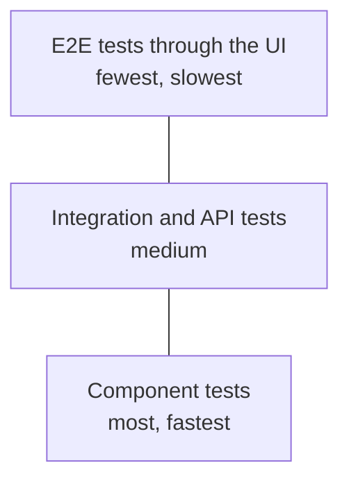

# Test automation strategy

Automation does not replace the tester. It takes over repetitive checks so that people have time for testing a machine cannot do: exploration, judging usability, thinking about risk.

## What to automate

| Worth automating | Usually not worth it |
|---|---|
| regression tests run on every change | one-off tests |
| smoke tests after every deployment | features that still change often |
| API and business logic tests | judging appearance and usability |
| tests with many data sets | scenarios that need human judgement |
| performance and load tests | tests that cost more to build than to run manually over the product's lifetime |

!!! tip "A quick check"
    Will this test run many times, give an unambiguous result and check something important? If any answer is “no”, automation will probably not pay off.

## Test pyramid

| Layer | Speed | Maintenance cost | What it finds |
|---|---|---|---|
| **Component** | milliseconds | low | logic errors in single functions |
| **Integration and API** | seconds | medium | errors between components, contracts and databases |
| **E2E through the UI** | minutes | high | errors in complete user journeys |

!!! warning "Inverted pyramid (ice-cream cone)"
    When most tests run through the UI, the suite is slow, brittle and expensive to maintain. Check logic lower down, and use the UI only for the most important journeys, e.g. sign-up, purchase, payment.

## Flaky tests

A **flaky test** sometimes passes and sometimes fails although the code has not changed. Such tests teach the team to ignore red builds, so treat them as defects.

| Typical cause | How to deal with it |
|---|---|
| fixed delays (`sleep`) and races with page loading | waiting for a specific condition: a visible element, an API response |
| tests that depend on each other or on the order | every test prepares and cleans up its own data |
| shared, changing test data | unique data per test, e.g. an e-mail with a random suffix |
| dependency on external services | mocks or a controlled test environment |
| brittle selectors, e.g. based on the position in the DOM | stable attributes, e.g. `data-testid`, roles and labels |
| time zone, date, randomness | fixed values in the test |

Mark a flaky test, quarantine it and fix it, instead of re-running it until it passes.

## Maintaining tests

- **Page Object Model**: selectors and page actions live in one class, tests only describe the scenario. A UI change needs a fix in one place.
- **Independent tests**: each can run on its own and in any order.
- **Clear names and assertions**: the test name and the failure message say what is broken.
- **Test code is code**: it goes through code review, lives in [Git](../tools/git/git_basics.md) and has standards.

## Automation in CI/CD

| When | What to run |
|---|---|
| on every commit or pull request | component tests, fast API tests, static analysis |
| after the build is deployed to the test environment | smoke tests, integration tests, selected E2E tests |
| nightly or before a release | full E2E regression, performance tests, security scans |

Configuration examples: [Jenkins](../tools/ci_cd/jenkins.md), [GitHub Actions](../tools/ci_cd/github_actions.md). Tools: [Selenium](../tools/automation/selenium.md), [Cypress](../tools/automation/cypress.md), [API automation](../technologies/api_testing/api_automation.md).

## Measuring results

- time from a commit to feedback from tests,
- share of flaky tests,
- defects found by automation vs reported from production,
- time spent maintaining tests compared to writing them.

High code coverage is not a goal in itself: a test without a meaningful assertion raises coverage but checks nothing.
