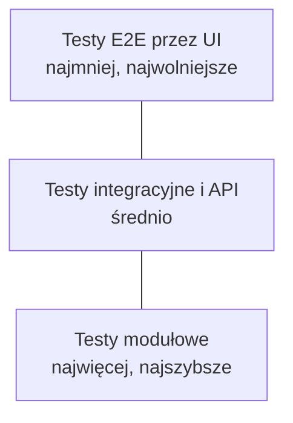

# Strategia automatyzacji testów

Automatyzacja nie zastępuje testera. Przejmuje powtarzalne sprawdzenia, żeby człowiek miał czas na testy, których maszyna nie zrobi: eksplorację, ocenę użyteczności, myślenie o ryzyku.

## Co automatyzować

| Warto automatyzować | Zwykle nie warto |
|---|---|
| testy regresji wykonywane przy każdej zmianie | testy jednorazowe |
| smoke testy po każdym wdrożeniu | funkcje, które jeszcze często się zmieniają |
| testy API i logiki biznesowej | ocenę wyglądu i użyteczności |
| testy z wieloma zestawami danych | scenariusze wymagające ludzkiej oceny |
| testy wydajności i obciążenia | testy, których przygotowanie kosztuje więcej niż ręczne wykonanie przez cały okres życia produktu |

!!! tip "Pytanie kontrolne"
    Czy ten test będzie wykonywany wiele razy, daje jednoznaczny wynik i sprawdza coś ważnego? Jeśli na któreś pytanie odpowiedź brzmi „nie”, automatyzacja raczej się nie zwróci.

## Piramida testów

| Warstwa | Szybkość | Koszt utrzymania | Co wykrywa |
|---|---|---|---|
| **Modułowe** | milisekundy | niski | błędy w logice pojedynczych funkcji |
| **Integracyjne i API** | sekundy | średni | błędy na styku modułów, kontraktów i baz danych |
| **E2E przez UI** | minuty | wysoki | błędy w pełnych ścieżkach użytkownika |

!!! warning "Odwrócona piramida (rożek lodów)"
    Gdy większość testów działa przez UI, zestaw jest wolny, kruchy i drogi w utrzymaniu. Logikę lepiej sprawdzać niżej, a przez UI tylko najważniejsze ścieżki, np. rejestrację, zakup, płatność.

## Niestabilne testy (flaky tests)

**Flaky test** raz przechodzi, a raz nie, choć kod się nie zmienił. Takie testy uczą zespół ignorować czerwone buildy, więc trzeba je traktować jak defekty.

| Typowa przyczyna | Jak sobie radzić |
|---|---|
| sztywne opóźnienia (`sleep`) i wyścigi z ładowaniem strony | czekanie na konkretny warunek: widoczny element, odpowiedź API |
| testy zależne od siebie lub od kolejności | każdy test sam przygotowuje i sprząta swoje dane |
| współdzielone, zmieniające się dane testowe | unikalne dane na test, np. e-mail z losowym sufiksem |
| zależność od zewnętrznych usług | atrapy (mocki) lub kontrolowane środowisko testowe |
| kruche selektory, np. oparte na pozycji w DOM | stabilne atrybuty, np. `data-testid`, role i etykiety |
| strefa czasowa, data, losowość | ustalone wartości w teście |

Niestabilny test należy oznaczyć, odłożyć do kwarantanny i naprawić, a nie wielokrotnie uruchamiać ponownie, aż przejdzie.

## Utrzymanie testów

- **Page Object Model**: selektory i akcje na stronie w jednej klasie, testy opisują tylko scenariusz. Zmiana w UI wymaga poprawki w jednym miejscu.
- **Testy niezależne**: każdy można uruchomić osobno i w dowolnej kolejności.
- **Czytelne nazwy i asercje**: z nazwy testu i komunikatu błędu wynika, co nie działa.
- **Kod testów to też kod**: przechodzi code review, jest w [Git](../tools/git/git_basics.md), ma standardy.

## Automatyzacja w CI/CD

| Kiedy | Co uruchamiać |
|---|---|
| przy każdym commicie lub pull requeście | testy modułowe, szybkie testy API, analizę statyczną |
| po złożeniu buildu na środowisku testowym | smoke testy, testy integracyjne, wybrane E2E |
| co noc lub przed wydaniem | pełną regresję E2E, testy wydajności, skany bezpieczeństwa |

Przykłady konfiguracji: [Jenkins](../tools/ci_cd/jenkins.md), [GitHub Actions](../tools/ci_cd/github_actions.md). Narzędzia: [Selenium](../tools/automation/selenium.md), [Cypress](../tools/automation/cypress.md), [automatyzacja API](../technologies/api_testing/api_automation.md).

## Mierzenie efektów

- czas od commita do informacji zwrotnej z testów,
- odsetek niestabilnych testów,
- defekty wykryte przez automatyzację w porównaniu ze zgłoszonymi z produkcji,
- czas utrzymania testów w stosunku do czasu ich pisania.

Wysokie pokrycie kodu samo w sobie nie jest celem: test bez sensownej asercji podnosi pokrycie, ale niczego nie sprawdza.
