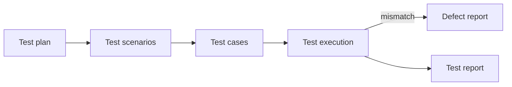

# Test documentation

Test documentation organises the test process, makes team communication easier and lets you reconstruct **what was tested, how, and with what result**.

## Test plan

A **test plan** describes the objectives, scope, approach, resources and schedule of testing. Precisely written information helps avoid misunderstandings, unclear roles and wrong project assumptions.

- There is no single mandatory template. Its shape depends on company policy, the type of project, the methodology and the team's organisation.
- It is usually written by the **test lead** or test manager, often with help from a few other people.

??? abstract "Typical contents of a test plan"

    1. Introduction and context (objectives, stakeholders, test basis)
    2. Test scope (levels and types, including what is excluded)
    3. Test items
    4. Product and project risks
    5. Test approach (techniques, levels of automation)
    6. Entry / exit criteria
    7. List of requirements / features to be tested
    8. Test environment and test data
    9. Schedule and estimates
    10. Reporting and metrics
    11. List of tools
    12. Defect management (severity and priority scales, lifecycle)
    13. Roles and responsibilities

## Test scenario

A **test scenario** is a set of test cases needed to check a specific feature. Each scenario should reflect **exactly one feature**.

Elements of a scenario:

- scenario identification,
- preparatory activities,
- list of test cases,
- closing activities.

## Test case

A test case answers the question: **“How will I check a given test condition?”** (a test condition answers “what do I check?”). It describes one specific test: preconditions, data, steps and the expected result.

A **test suite** is a set of test cases grouped to be executed together, e.g. all regression tests of the cart, or the smoke tests run after every deployment.

| Field | Description |
|---|---|
| **ID** | unique identifier, e.g. `TC-LOGIN-001` |
| **Title** | briefly: what is being checked |
| **Preconditions** | what must be true before the test |
| **Test data** | specific input values |
| **Steps** | numbered actions |
| **Expected result** | what should happen according to the requirements |
| **Actual result** | what actually happened |
| **Postconditions** | system state after the test |
| **Status** | Pass / Fail / Blocked / Not run |

=== "Positive"

    **TC-LOGIN-001: Logging in with valid credentials**

    - **Preconditions:** user `jan@test.pl` exists and is active
    - **Steps:**
        1. Open the `/login` page
        2. Enter the e-mail `jan@test.pl`
        3. Enter the correct password
        4. Click **Log in**
    - **Expected result:** redirect to `/dashboard`, the user's first name is visible in the header

=== "Negative"

    **TC-LOGIN-004: Logging in with a wrong password**

    - **Preconditions:** user `jan@test.pl` exists and is active
    - **Steps:**
        1. Open the `/login` page
        2. Enter the e-mail `jan@test.pl`
        3. Enter the password `Wrong-pass1`
        4. Click **Log in**
    - **Expected result:** the user stays on `/login` and sees the message *“Invalid e-mail or password”*; the message does not reveal whether the account exists

=== "Boundary values"

    **TC-REG-010: Password length at sign-up (requirement: 8–64 characters)**

    Designed with [boundary value analysis](test_techniques.md#boundary-value-analysis), 2-value version:

    | Test data: password length | Expected result |
    |---|---|
    | 7 characters | validation error *“The password must have at least 8 characters”* |
    | 8 characters | account created |
    | 64 characters | account created |
    | 65 characters | validation error *“The password can have at most 64 characters”* |

A **test script** is a manual or automated set of instructions that implements a test case. The same test case can be executed many times in different configurations, e.g. in Chrome, Firefox and Safari.

## Defect report

A good report lets a developer **reproduce the bug without asking follow-up questions**.

| Field | Example |
|---|---|
| ID | `BUG-142` |
| Title | *Cart: changing the quantity to 0 does not remove the product* |
| Environment | Chrome 130, Windows 11, QA environment, build 1.4.2 |
| Steps to reproduce | 1. Add a product to the cart 2. Change the quantity to 0 3. Click “Recalculate” |
| Expected result | the product is removed from the cart |
| Actual result | the product stays with quantity 0, total = 0 PLN |
| Severity / priority | Major / Medium |
| Attachments | screenshot, recording, console logs, request from the Network tab |

??? abstract "Defect report fields according to ISTQB CTFL v4.0"

    unique identifier · title and short summary · date of the report, issuing organisation and author · identification of the test object and test environment · context of the defect (e.g. the test case being run, the test phase) · description of the failure that allows reproduction, with steps and evidence (logs, screenshots, recordings) · expected and actual results · severity (impact on stakeholders and requirements) · priority to fix · status · references (e.g. to the test case)

### Severity vs priority

These are two different fields and a frequent interview question.

| | Severity | Priority |
|---|---|---|
| **What it describes** | how serious the **impact** of the defect on the system and the user is | how **urgently** it needs to be fixed |
| **Usually set by** | the tester | the product owner, project manager or team |
| **Depends on** | technical consequences: data loss, crash, wrong calculations | business needs: release date, number of users, reputation |

Typical scales: severity **critical / major / medium / minor**, priority **high / medium / low**. The two values can differ:

| Example | Severity | Priority |
|---|---|---|
| A typo in the company name on the home page | minor | **high**: every customer sees it |
| A crash when exporting a rarely used annual report | **critical** | low: the report is needed once a year and there is a workaround |
| Card payment does not work on the day of a promotional campaign | **critical** | **high** |
| A footer icon shifted by 2 px | minor | low |

### Weak and good reports

=== "Weak report"

    **Title:** Cart does not work

    **Description:** Something is wrong with the cart, a product cannot be removed. Please fix.

    Missing: environment, version, steps, expected and actual result, evidence. The developer has to ask follow-up questions, or the report comes back as **Cannot Reproduce**.

=== "Good report"

    **Title:** Cart: changing the quantity to 0 does not remove the product

    **Environment:** Chrome 130, Windows 11, QA environment, build 1.4.2

    **Steps:**

    1. Log in as `jan@test.pl`.
    2. Add the product *QA Mug* to the cart.
    3. In the cart, change the quantity to `0`.
    4. Click **Recalculate**.

    **Expected result:** the product is removed from the cart.
    **Actual result:** the product stays with quantity 0, total = 0 PLN. Reproducibility: 5/5.

    **Attachments:** screen recording, the `PATCH /cart/items/17` response from the Network tab.

!!! tip "Good practices"
    - One report = one defect.
    - Title in the format *Where: what happens*.
    - Always include the version/build and the environment.
    - Describe facts, do not judge people.
    - Attach evidence: a screenshot ([PicPick, ShareX](../tools/browser_tools.md#screenshots-and-recordings)), a recording, logs from [DevTools](../tools/devtools.md).
