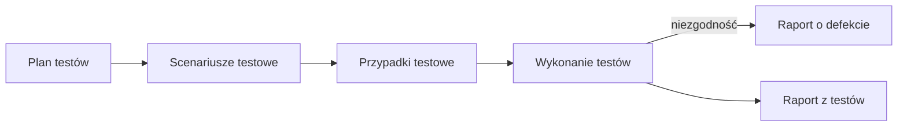

# Dokumentacja testowa

Dokumentacja testowa porządkuje proces testowy, ułatwia komunikację w zespole i pozwala odtworzyć, **co, jak i z jakim wynikiem** zostało przetestowane.

## Plan testów

**Plan testów** opisuje cele, zakres, podejście, zasoby i harmonogram testowania. Precyzyjnie spisane informacje pozwalają uniknąć niedomówień, źle rozumianych ról i założeń projektowych.

- Nie ma jednego obowiązującego wzoru. Wygląd zależy od polityki firmy, rodzaju projektu, metodyki i organizacji zespołu.
- Zwykle tworzy go **lider zespołu testowego** lub kierownik testów, często z pomocą kilku osób.

??? abstract "Typowa zawartość planu testów"

    1. Wstęp i kontekst (cele, interesariusze, podstawa testów)
    2. Zakres testów (poziomy i typy, także wykluczone)
    3. Przedmiot testów
    4. Ryzyka produktowe i projektowe
    5. Podejście do testów (techniki, poziomy automatyzacji)
    6. Kryteria wejścia / wyjścia
    7. Lista wymagań / funkcji do przetestowania
    8. Środowisko testowe i dane testowe
    9. Harmonogram i szacowanie
    10. Raportowanie i metryki
    11. Lista narzędzi
    12. Zarządzanie defektami (skale ważności i priorytetu, cykl życia)
    13. Role i odpowiedzialność

## Scenariusz testowy

**Scenariusz testowy** to zbiór przypadków testowych potrzebnych do sprawdzenia określonej funkcjonalności. Każdy scenariusz powinien odzwierciedlać **dokładnie jedną funkcjonalność**.

Elementy scenariusza:

- identyfikacja scenariusza,
- czynności przygotowawcze,
- wykaz przypadków testowych,
- czynności końcowe.

## Przypadek testowy

Przypadek testowy odpowiada na pytanie: **„Jak sprawdzę dany warunek testowy?”** (warunek testowy odpowiada na pytanie „co sprawdzam?”). Opisuje jeden konkretny test: warunki wstępne, dane, kroki i wynik oczekiwany.

**Zestaw testów (test suite)** to zbiór przypadków testowych zgrupowanych w celu wspólnego wykonania, np. wszystkie testy regresji koszyka albo smoke testy wykonywane po każdym wdrożeniu.

| Pole | Opis |
|---|---|
| **ID** | unikalny identyfikator, np. `TC-LOGIN-001` |
| **Tytuł** | krótko: co sprawdzamy |
| **Warunki wstępne** | co musi być spełnione przed testem |
| **Dane testowe** | konkretne wartości wejściowe |
| **Kroki** | ponumerowane akcje |
| **Wynik oczekiwany** | co powinno się stać wg wymagań |
| **Wynik rzeczywisty** | co się stało |
| **Warunki końcowe** | stan systemu po teście |
| **Status** | Pass / Fail / Blocked / Not run |

=== "Pozytywny"

    **TC-LOGIN-001: Logowanie poprawnymi danymi**

    - **Warunki wstępne:** użytkownik `jan@test.pl` istnieje i jest aktywny
    - **Kroki:**
        1. Otwórz stronę `/login`
        2. Wpisz e-mail `jan@test.pl`
        3. Wpisz poprawne hasło
        4. Kliknij **Zaloguj**
    - **Wynik oczekiwany:** przekierowanie do `/dashboard`, w nagłówku widoczne imię użytkownika

=== "Negatywny"

    **TC-LOGIN-004: Logowanie błędnym hasłem**

    - **Warunki wstępne:** użytkownik `jan@test.pl` istnieje i jest aktywny
    - **Kroki:**
        1. Otwórz stronę `/login`
        2. Wpisz e-mail `jan@test.pl`
        3. Wpisz hasło `Zle-haslo1`
        4. Kliknij **Zaloguj**
    - **Wynik oczekiwany:** użytkownik zostaje na `/login`, widoczny komunikat *„Nieprawidłowy e-mail lub hasło”*; komunikat nie zdradza, czy konto istnieje

=== "Wartości brzegowe"

    **TC-REG-010: Długość hasła przy rejestracji (wymaganie: 8–64 znaki)**

    Przypadek zaprojektowany [analizą wartości brzegowych](test_techniques.md#analiza-wartosci-brzegowych), wersja 2-wartościowa:

    | Dane testowe: długość hasła | Wynik oczekiwany |
    |---|---|
    | 7 znaków | błąd walidacji *„Hasło musi mieć co najmniej 8 znaków”* |
    | 8 znaków | konto utworzone |
    | 64 znaki | konto utworzone |
    | 65 znaków | błąd walidacji *„Hasło może mieć najwyżej 64 znaki”* |

**Skrypt testowy** to ręczny lub zautomatyzowany zestaw instrukcji implementujących przypadek testowy. Ten sam przypadek można wykonać wielokrotnie w różnych konfiguracjach, np. w Chrome, Firefox i Safari.

## Raport o defekcie

Dobry raport pozwala programiście **odtworzyć defekt bez dopytywania**.

| Pole | Przykład |
|---|---|
| ID | `BUG-142` |
| Tytuł | *Koszyk: zmiana ilości na 0 nie usuwa produktu* |
| Środowisko | Chrome 130, Windows 11, środowisko QA, build 1.4.2 |
| Kroki do odtworzenia | 1. Dodaj produkt do koszyka 2. Zmień ilość na 0 3. Kliknij „Przelicz” |
| Wynik oczekiwany | produkt zostaje usunięty z koszyka |
| Wynik rzeczywisty | produkt zostaje z ilością 0, suma = 0 zł |
| Ważność / priorytet | Poważna / Średni |
| Załączniki | zrzut ekranu, nagranie, logi z konsoli, request z zakładki Network |

??? abstract "Pola raportu o defekcie wg ISTQB CTFL v4.0"

    unikatowy identyfikator · tytuł i krótkie podsumowanie · data zgłoszenia, organizacja zgłaszająca i autor · identyfikacja przedmiotu testów i środowiska testowego · kontekst defektu (np. wykonywany przypadek testowy, faza testów) · opis awarii umożliwiający odtworzenie, z krokami i dowodami (logi, zrzuty ekranu, nagrania) · wynik oczekiwany i rzeczywisty · ważność (wpływ na interesariuszy i wymagania) · priorytet naprawy · status · odwołania (np. do przypadku testowego)

### Ważność a priorytet

To dwa różne pola i często pytanie na rozmowie rekrutacyjnej.

| | Ważność (severity) | Priorytet (priority) |
|---|---|---|
| **Co opisuje** | jak poważny jest **wpływ** defektu na system i użytkownika | jak **pilnie** trzeba go naprawić |
| **Kto zwykle ustala** | tester | właściciel produktu, kierownik projektu, zespół |
| **Od czego zależy** | skutki techniczne: utrata danych, awaria, błędne obliczenia | potrzeby biznesu: termin wydania, liczba użytkowników, wizerunek |

Typowe skale: ważność **krytyczna / poważna / średnia / niska**, priorytet **wysoki / średni / niski**. Obie wartości mogą się od siebie różnić:

| Przykład | Ważność | Priorytet |
|---|---|---|
| Literówka w nazwie firmy na stronie głównej | niska | **wysoki**: widzi ją każdy klient |
| Awaria aplikacji przy eksporcie rzadko używanego raportu rocznego | **krytyczna** | niski: raport jest potrzebny raz w roku, jest obejście |
| Płatność kartą nie działa w dniu kampanii promocyjnej | **krytyczna** | **wysoki** |
| Ikona w stopce przesunięta o 2 px | niska | niski |

### Słaby i dobry raport

=== "Słaby raport"

    **Tytuł:** Koszyk nie działa

    **Opis:** Coś jest nie tak z koszykiem, nie da się usunąć produktu. Proszę naprawić.

    Brakuje: środowiska, wersji, kroków, wyniku oczekiwanego i rzeczywistego, dowodów. Programista musi dopytywać albo zgłoszenie wraca jako **Cannot Reproduce**.

=== "Dobry raport"

    **Tytuł:** Koszyk: zmiana ilości na 0 nie usuwa produktu

    **Środowisko:** Chrome 130, Windows 11, środowisko QA, build 1.4.2

    **Kroki:**

    1. Zaloguj się jako `jan@test.pl`.
    2. Dodaj do koszyka produkt *Kubek QA*.
    3. W koszyku zmień ilość na `0`.
    4. Kliknij **Przelicz**.

    **Wynik oczekiwany:** produkt zostaje usunięty z koszyka.
    **Wynik rzeczywisty:** produkt zostaje z ilością 0, suma = 0 zł. Odtwarzalność: 5/5.

    **Załączniki:** nagranie ekranu, odpowiedź `PATCH /cart/items/17` z zakładki Network.

!!! tip "Dobre praktyki"
    - Jeden raport = jeden defekt.
    - Tytuł w formacie *Gdzie: co się dzieje*.
    - Zawsze podawaj wersję/build i środowisko.
    - Opisuj fakty, nie oceniaj osób.
    - Dołącz dowody: zrzut ekranu ([PicPick, ShareX](../tools/browser_tools.md#zrzuty-ekranu-i-nagrania)), nagranie, logi z [DevTools](../tools/devtools.md).
