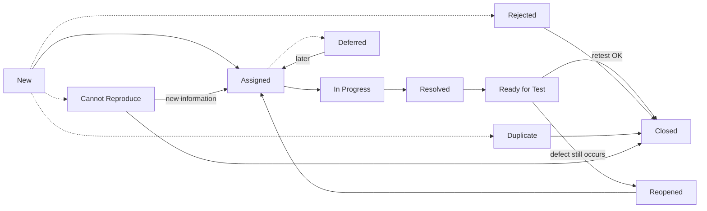

# Test management

## Independence of testing

Testing tasks can be performed by people in the tester role, but also by others (e.g. developers). A certain degree of independence **makes defect detection more effective**, because the author and the tester have different cognitive biases. Authors often do not see their own mistakes.

=== "Benefits"

    - stronger focus on testing,
    - more effective at finding defects and failures,
    - an independent view from a trained team,
    - verification of assumptions made by the author.

=== "Drawbacks"

    - testers isolated from the development team: worse communication, delayed feedback,
    - developers may lose their sense of responsibility for quality,
    - independent testers may lack important information about the product,
    - testers may be seen as a “bottleneck”.

## Test planning

Planning is influenced by: the organisation's test policy and strategy, the development lifecycle and methodology, the scope and objectives of testing, risks, constraints and the criticality of the system.

Planning activities:

- defining the scope, objectives and risks,
- choosing the overall test approach,
- integrating and coordinating test activities with the lifecycle,
- deciding **what** to test, **who** tests it and **with which resources**,
- planning test analysis, design, implementation, execution and evaluation,
- choosing metrics for monitoring and control.

## Entry and exit criteria

| | Entry criteria | Exit criteria |
|---|---|---|
| **What they define** | conditions that must be met **before** a test activity starts | conditions under which a test level or set of tests is considered **complete** |
| **Examples** | test environment available, test data ready, code passed unit tests, documentation available | all planned tests executed, coverage achieved, no open critical defects, defect density below the threshold |

!!! note "Definition of Ready / Definition of Done"
    In agile methodologies the equivalents are **DoR** (entry criteria for a user story) and **DoD** (exit criteria).

## Test schedule

The schedule should take into account:

- **priorities** (the most important and riskiest tests first),
- technical and logical **dependencies** between tests,
- time for **retests** (confirmation testing) and **regression testing**.

Typical test prioritisation strategies according to ISTQB:

| Strategy | Order |
|---|---|
| **Risk-based** | tests of the areas with the highest risk level first |
| **Coverage-based** | tests that achieve the highest coverage (e.g. of code or requirements) first |
| **Requirements-based** | the order follows the requirement priorities set by stakeholders |

## Configuration management

**Configuration management** makes it possible to identify and version every test item unambiguously: the test object (build, version), test cases and scripts, test data and the environment. This way you know **what** a test was run on, and it can be repeated. In practice this is done with version control ([Git](../tools/git/git_basics.md)), build numbers from [CI/CD](../tools/ci_cd/jenkins.md) and test management tools.

## Monitoring and control

- **Monitoring**: gathering information about test progress (manually or automatically in test management tools).
- **Control**: corrective actions taken based on that information (e.g. changing priorities, adding resources).

Typical metrics: test execution progress, number of passed/failed tests, number and density of defects, defect detection percentage (DDP), mean time to fix, requirements and code coverage, residual risk level, cost of testing.

| Report | When | What it contains |
|---|---|---|
| **Test progress report** | regularly during testing | status against the plan, metrics, blockers, new risks |
| **Test completion report** | at the end of a stage or project | summary, deviations from the plan, exit criteria assessment, unresolved defects, lessons learned |

## Risk and testing

According to the ISTQB glossary, a **risk** is a factor that could result in future negative consequences. It is described by **likelihood** and **impact**.

The **risk level** is determined by likelihood and impact. It can be assessed qualitatively in a risk matrix or numerically, e.g. as **likelihood × impact** on a 1–5 scale.

-   **Product (quality) risk**

    ---

    The product may not meet users' needs, e.g. wrong calculations, poor performance, security holes, bad usability.

-   **Project risk**

    ---

    Threatens the achievement of project objectives, e.g. delays, lack of people or skills, changing requirements, supplier problems.

**Risk-based testing** means that the scope, priorities and test techniques are chosen based on risk analysis, so that the riskiest areas are tested first and most thoroughly.

There are four ways to respond to an identified risk: **mitigate** it (e.g. extra testing, reviews), **accept** it, **transfer** it (e.g. to a supplier) or prepare a **contingency plan**.

## Defect management

One of the objectives of testing is to find defects, so **all defects found should be logged**. How they are reported depends on the context, the test level and the development model.

### Defect lifecycle

Status names differ between tools and companies, but the flow is similar.

| Status | Meaning |
|---|---|
| **New** | the report has been created and waits for analysis |
| **Assigned** | assigned to the person who will fix it |
| **In Progress** | the fix is in progress |
| **Resolved** | the developer considers the defect fixed |
| **Ready for Test** | the fix is in a build on the test environment and waits for a retest |
| **Closed** | the retest passed, or the report was closed without a fix (rejected, duplicate, cannot reproduce) |
| **Reopened** | the retest showed that the defect still occurs |
| **Rejected** | not a defect, e.g. the behaviour matches the specification or the test was wrong |
| **Duplicate** | the same defect has already been reported; the report is linked to the original |
| **Deferred** | the defect is confirmed, but the fix is postponed, e.g. because of low priority |
| **Cannot Reproduce** | the defect could not be reproduced; usually more information is needed from the reporter |

Report fields in detail: [Test documentation → Defect report](test_documentation.md#defect-report). How it works in practice: [Jira](../tools/test_management/jira.md).
