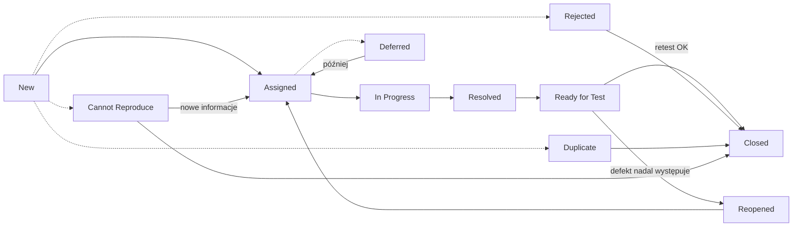

# Zarządzanie testami

## Niezależność testowania

Zadania testowe mogą wykonywać osoby pełniące rolę testera, ale też inne osoby (np. programiści). Pewien stopień niezależności **zwiększa skuteczność wykrywania defektów**, bo autor i tester mają różne błędy poznawcze. Autor często nie widzi własnych pomyłek.

=== "Zalety"

    - większy nacisk na testy,
    - większa skuteczność w znajdowaniu defektów i awarii,
    - niezależne spojrzenie wyszkolonego zespołu,
    - weryfikacja założeń przyjętych przez autora.

=== "Wady"

    - izolacja testerów od zespołu wytwórczego: gorsza komunikacja, opóźnienia w informacji zwrotnej,
    - programiści mogą stracić poczucie odpowiedzialności za jakość,
    - niezależni testerzy mogą nie mieć ważnych informacji o produkcie,
    - testerzy mogą być postrzegani jako „wąskie gardło”.

## Planowanie testów

Na planowanie wpływają: polityka i strategia testów w organizacji, cykl życia i metodyka wytwarzania, zakres i cele testowania, ryzyka, ograniczenia oraz krytyczność systemu.

Czynności planowania:

- określenie zakresu, celów i ryzyk,
- wybór ogólnego podejścia do testowania,
- integrowanie i koordynowanie czynności testowych z cyklem życia,
- decyzja, **co** testować, **kto** i **jakimi zasobami**,
- planowanie analizy, projektowania, implementacji, wykonania i oceny testów,
- wybór metryk do monitorowania i nadzoru.

## Kryteria wejścia i wyjścia

| | Kryteria wejścia | Kryteria wyjścia |
|---|---|---|
| **Co określają** | warunki, które muszą być spełnione **przed** rozpoczęciem czynności testowej | warunki, po spełnieniu których dany poziom lub zbiór testów uznaje się za **zakończony** |
| **Przykłady** | dostępne środowisko testowe, gotowe dane testowe, kod przeszedł testy modułowe, dostępna dokumentacja | wykonane wszystkie zaplanowane testy, osiągnięte pokrycie, brak otwartych defektów krytycznych, gęstość defektów poniżej progu |

!!! note "Definition of Ready / Definition of Done"
    W metodykach zwinnych odpowiednikami są **DoR** (kryteria wejścia dla historyjki) i **DoD** (kryteria wyjścia).

## Harmonogram testów

Harmonogram powinien uwzględniać:

- **priorytety** (najpierw testy najważniejsze i najbardziej ryzykowne),
- **zależności** techniczne i logiczne między testami,
- czas na **retesty** (testy potwierdzające) i **testy regresji**.

Typowe strategie ustalania kolejności testów wg ISTQB:

| Strategia | Kolejność |
|---|---|
| **Oparta na ryzyku** | najpierw testy obszarów o najwyższym poziomie ryzyka |
| **Oparta na pokryciu** | najpierw testy, które dają największe pokrycie (np. kodu lub wymagań) |
| **Oparta na wymaganiach** | kolejność wynika z priorytetów wymagań ustalonych przez interesariuszy |

## Zarządzanie konfiguracją

**Zarządzanie konfiguracją** pozwala jednoznacznie zidentyfikować i wersjonować wszystkie elementy testów: przedmiot testów (build, wersję), przypadki i skrypty testowe, dane testowe i środowisko. Dzięki temu wiadomo, **na czym** wykonano test i da się go powtórzyć. W praktyce służą do tego system kontroli wersji ([Git](../tools/git/git_basics.md)), numery buildów z [CI/CD](../tools/ci_cd/jenkins.md) i narzędzia do zarządzania testami.

## Monitorowanie i nadzór

- **Monitorowanie**: zbieranie informacji o przebiegu testów (ręcznie lub automatycznie w narzędziach do zarządzania testami).
- **Nadzór**: działania korygujące podejmowane na podstawie tych informacji (np. zmiana priorytetów, dodatkowe zasoby).

Typowe metryki: postęp wykonania testów, liczba testów pass/fail, liczba i gęstość defektów, odsetek wykrytych defektów (DDP), średni czas naprawy, pokrycie wymagań i kodu, poziom ryzyka rezydualnego, koszt testowania.

| Raport | Kiedy | Co zawiera |
|---|---|---|
| **Raport z postępu testów** | regularnie w trakcie testów | status względem planu, metryki, blokery, nowe ryzyka |
| **Raport z ukończenia testów** | na koniec etapu lub projektu | podsumowanie, odchylenia od planu, ocena kryteriów wyjścia, nierozwiązane defekty, wnioski |

## Ryzyko a testowanie

Wg słownika ISTQB **ryzyko** to czynnik, który w przyszłości może skutkować negatywnymi konsekwencjami. Opisuje się je przez **prawdopodobieństwo** i **wpływ**.

**Poziom ryzyka** wynika z prawdopodobieństwa i wpływu. Można go ocenić jakościowo w macierzy ryzyka albo liczbowo, np. jako **prawdopodobieństwo × wpływ** na skali 1–5.

-   **Ryzyko produktowe (jakościowe)**

    ---

    Produkt może nie spełnić potrzeb użytkowników, np. błędne obliczenia, słaba wydajność, luki bezpieczeństwa, zła użyteczność.

-   **Ryzyko projektowe**

    ---

    Zagraża osiągnięciu celów projektu, np. opóźnienia, brak ludzi lub kompetencji, zmiany wymagań, problemy z dostawcami.

**Testowanie oparte na ryzyku** oznacza, że na podstawie analizy ryzyka wybiera się zakres, priorytety i techniki testów, aby obszary najbardziej ryzykowne testować najwcześniej i najdokładniej.

Na zidentyfikowane ryzyko można zareagować na cztery sposoby: **ograniczyć** je (np. dodatkowe testy, przeglądy), **zaakceptować**, **przenieść** (np. na dostawcę) albo przygotować **plan awaryjny**.

## Zarządzanie defektami

Jednym z celów testowania jest znajdowanie defektów, więc **wszystkie znalezione defekty należy rejestrować**. Sposób zgłaszania zależy od kontekstu, poziomu testów i modelu wytwórczego.

### Cykl życia defektu

Nazwy statusów różnią się między narzędziami i firmami, ale przebieg jest podobny.

| Status | Znaczenie |
|---|---|
| **New** | zgłoszenie utworzone, czeka na analizę |
| **Assigned** | przypisane do osoby, która je naprawi |
| **In Progress** | trwa naprawa |
| **Resolved** | programista uznał defekt za naprawiony |
| **Ready for Test** | poprawka jest w buildzie na środowisku testowym, czeka na retest |
| **Closed** | retest zakończony sukcesem albo zgłoszenie zamknięte bez naprawy (odrzucone, duplikat, nie do odtworzenia) |
| **Reopened** | retest wykazał, że defekt nadal występuje |
| **Rejected** | to nie defekt, np. działanie zgodne ze specyfikacją albo błąd w teście |
| **Duplicate** | ten sam defekt został już zgłoszony; zgłoszenie łączy się z pierwotnym |
| **Deferred** | defekt potwierdzony, ale naprawa odłożona na później, np. ze względu na niski priorytet |
| **Cannot Reproduce** | nie udało się odtworzyć defektu; zwykle potrzeba więcej informacji od zgłaszającego |

Szczegóły pól raportu: [Dokumentacja testowa → Raport o defekcie](test_documentation.md#raport-o-defekcie). Obsługa w praktyce: [Jira](../tools/test_management/jira.md).
