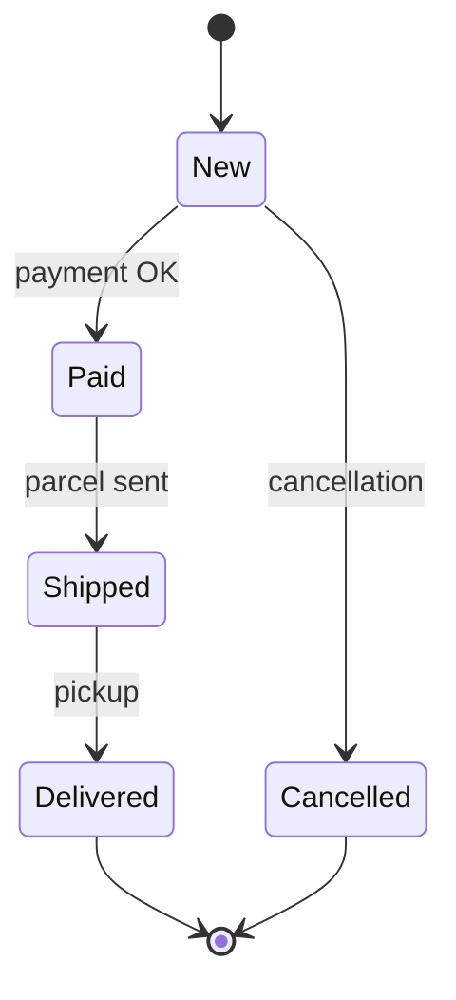

# Test techniques

Test techniques help you **design test cases systematically**, so that a limited number of tests finds as many defects as possible.

## Choosing a technique

Many factors influence the choice of a technique. They can be grouped into three categories:

| Group | Examples |
|---|---|
| **Formal** | documentation, contractual requirements, applicable laws and standards |
| **Product** | type of software, its complexity, criticality, risks |
| **Project** | available time, budget, resources, team skills |

## Technique categories

The ISTQB CTFL syllabus groups techniques into three categories:

<div class="grid cards" markdown>

-   **Black-box**

    ---

    Also called **behavioural** or **specification-based**. They rely on knowledge of *how the system should behave* (requirements, use cases, user stories), without looking at the code.

-   **White-box**

    ---

    Also called **structural**. Test design is based on the *internal structure* of the test object, most often the source code.

-   **Experience-based**

    ---

    Not based on a formal document, but on the tester's *knowledge, intuition and experience*.

</div>

---

## Black-box techniques

### Equivalence partitioning

Input data is divided into **classes (partitions)** in which the system should behave the same way. Testing **one value** from each class is enough.

!!! example "Example: the “age” field accepts values 18–65"

    | Class | Range | Sample value | Expected result |
    |---|---|---|---|
    | invalid | < 18 | 10 | validation error |
    | **valid** | 18–65 | 30 | accepted |
    | invalid | > 65 | 80 | validation error |

    Coverage: **3 tests** cover 100% of the classes.

### Boundary value analysis

Defects very often occur **at the boundaries** of equivalence classes (e.g. `<` instead of `<=`). The technique focuses on testing boundary values:

- **2-value version**: the boundary value and its closest neighbour from the other class, e.g. `17, 18` and `65, 66`,
- **3-value version**: the boundary value and both neighbours, e.g. `17, 18, 19` and `64, 65, 66`.

### Decision tables

Used to test **combinations of conditions** and the resulting actions. Each column is one rule, i.e. one test case.

!!! example "Example: a shop discount"

    | Condition / action | R1 | R2 | R3 | R4 |
    |---|:-:|:-:|:-:|:-:|
    | Customer has a loyalty card | Y | Y | N | N |
    | Order value > 200 PLN | Y | N | Y | N |
    | **15% discount** | ✔ | | | |
    | **10% discount** | | ✔ | | |
    | **Free delivery** | ✔ | | ✔ | |

### State transition testing

Used when the system's behaviour depends on its **current state** and on events (e.g. order status, account lock after 3 wrong passwords).



Tests can cover all **states**, all **valid transitions**, or also **invalid transitions** (e.g. trying to ship an unpaid order).

### Coverage in black-box techniques

| Technique | Coverage = exercised / all |
|---|---|
| Equivalence partitioning | partitions covered by at least one test / all identified partitions |
| Boundary value analysis | boundary values tested / all identified boundary values |
| Decision tables | columns (rules) tested / all feasible columns |
| State transitions | states visited, valid transitions or all transitions exercised / their total number |

---

## White-box techniques

| Technique | What it measures | Notes |
|---|---|---|
| **Statement testing** | % of executed code statements | weakest coverage criterion |
| **Branch testing** | % of executed branches (decision outcomes) | 100% branches ⇒ 100% statements, but not the other way round |

**Coverage** = coverage items exercised by tests / all coverage items × 100%.

Example: the code has 10 statements and 4 branches (2 decisions). The tests execute 8 statements and 3 branches, so statement coverage is 80% and branch coverage is 75%.

!!! warning "100% coverage does not mean no defects"
    Full coverage only means that every code element was executed. It cannot reveal missing functionality or a wrong expected result.

!!! tip "Why does it matter to a tester?"
    Coverage reports (e.g. from Istanbul, JaCoCo, coverage.py) show which parts of the code **were not executed** by any test, so they point to where more tests are worth adding.

---

## Experience-based techniques

### Error guessing

**Error guessing** means anticipating defects based on knowledge of typical developer mistakes, e.g. an empty field, leading spaces, a very long text, special characters, negative numbers, 29 February.

### Exploratory testing

**Exploratory testing** means learning the application and designing, executing and evaluating tests at the same time. The result of one test suggests what to check next. It works well when the specification is poor, time is short or formal tests need to be complemented.

It is usually run as **time-boxed sessions** (session-based test management, SBTM):

1. A **test charter** sets the goal of the session: *what* to explore, *with what* and *to discover what*.
2. The **session** usually lasts 60–120 minutes, without switching to other tasks.
3. The tester keeps **notes** as they go: what they checked, what they found, open questions and ideas for further sessions.
4. A **debrief** with the test lead or the team: results, reported defects, risks, next steps.

!!! example "Example test charter"
    **Explore** the cart of an online shop **with** quantity changes, discount codes and several browser tabs **to discover** wrongly calculated totals and an inconsistent cart state.

    Time: 90 min · Environment: QA, build 2.3.0 · Tester: A. Kowalska

### Checklist-based testing

Tests are performed according to a **checklist**, a list of things to check, e.g. a checklist for forms, accessibility or UI at different resolutions. The list is built from experience, typical defects and requirements, and it needs regular updates.

!!! tip "Practical help"
    The **Bug Magnet** extension suggests ready-made sets of valid and invalid data for forms. Handy for error guessing (more in [Browsers and extensions](../tools/browser_tools.md)).

## Collaboration-based approaches

- **User stories** in the format *As a [role] I want [goal] so that [benefit]* with **acceptance criteria**. A story has three parts (**3C**): Card, Conversation and Confirmation (the acceptance criteria). A good story meets the **INVEST** criteria: independent, negotiable, valuable, estimable, small and testable.
- **Acceptance criteria** are written as rules (a list of conditions) or as scenarios (Given/When/Then).
- **ATDD** (acceptance test-driven development): test cases written together with the business from the acceptance criteria before implementation. **BDD** is a similar approach in which behaviour is described in Gherkin syntax:

```gherkin
Scenario: Logging in with valid credentials
  Given the user is on the login page
  When they enter a valid username and password
  Then they are redirected to the customer dashboard
```
