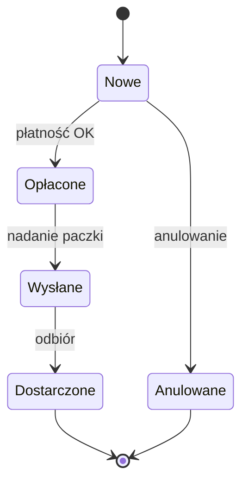

# Techniki testowania

Techniki testowania pomagają **systematycznie projektować przypadki testowe**, tak aby przy ograniczonej liczbie testów wykryć jak najwięcej defektów.

## Wybór techniki

Na wybór techniki wpływa wiele czynników, które można podzielić na trzy grupy:

| Grupa | Przykłady |
|---|---|
| **Formalne** | dokumentacja, wymagania umowne, obowiązujące prawo i normy |
| **Produktowe** | rodzaj oprogramowania, jego złożoność, krytyczność, ryzyka |
| **Projektowe** | dostępny czas, budżet, zasoby, umiejętności zespołu |

## Kategorie technik

Sylabus ISTQB CTFL grupuje techniki w trzy kategorie:

<div class="grid cards" markdown>

-   **Czarnoskrzynkowe**

    ---

    Inaczej **behawioralne** lub **oparte na specyfikacji**. Bazują na wiedzy o tym, *jak system powinien się zachowywać* (wymagania, przypadki użycia, historyjki użytkownika), bez zaglądania do kodu.

-   **Białoskrzynkowe**

    ---

    Inaczej **strukturalne**. Podstawą projektowania testów jest *wewnętrzna struktura* przedmiotu testów, najczęściej kod źródłowy.

-   **Oparte na doświadczeniu**

    ---

    Nie bazują na formalnym dokumencie, tylko na *wiedzy, intuicji i doświadczeniu* testera.

</div>

---

## Techniki czarnoskrzynkowe

### Podział na klasy równoważności

Dane wejściowe dzieli się na **klasy (partycje)**, w których system powinien zachowywać się tak samo. Z każdej klasy wystarczy przetestować **jedną wartość**.

!!! example "Przykład: pole „wiek” akceptuje wartości 18–65"

    | Klasa | Zakres | Przykładowa wartość | Oczekiwany wynik |
    |---|---|---|---|
    | niepoprawna | < 18 | 10 | błąd walidacji |
    | **poprawna** | 18–65 | 30 | akceptacja |
    | niepoprawna | > 65 | 80 | błąd walidacji |

    Pokrycie: **3 testy** pokrywają 100% klas.

### Analiza wartości brzegowych

Defekty bardzo często występują **na granicach** klas równoważności (np. `<` zamiast `<=`). Technika zakłada testowanie wartości granicznych:

- **wersja 2-wartościowa**: wartość brzegowa i jej najbliższy sąsiad z drugiej klasy, np. `17, 18` oraz `65, 66`,
- **wersja 3-wartościowa**: wartość brzegowa i obaj sąsiedzi, np. `17, 18, 19` oraz `64, 65, 66`.

### Tablice decyzyjne

Służą do testowania **kombinacji warunków** i wynikających z nich akcji. Każda kolumna to jedna reguła, czyli jeden przypadek testowy.

!!! example "Przykład: rabat w sklepie"

    | Warunek / akcja | R1 | R2 | R3 | R4 |
    |---|:-:|:-:|:-:|:-:|
    | Klient ma kartę stałego klienta | T | T | N | N |
    | Wartość zamówienia > 200 zł | T | N | T | N |
    | **Rabat 15%** | ✔ | | | |
    | **Rabat 10%** | | ✔ | | |
    | **Darmowa dostawa** | ✔ | | ✔ | |

### Testowanie przejść pomiędzy stanami

Stosowane, gdy zachowanie systemu zależy od **aktualnego stanu** i zdarzeń (np. status zamówienia, blokada konta po 3 błędnych hasłach).



Testy mogą pokrywać wszystkie **stany**, wszystkie **poprawne przejścia** lub również **przejścia niepoprawne** (np. próba wysłania nieopłaconego zamówienia).

---

## Techniki białoskrzynkowe

| Technika | Co mierzy | Uwagi |
|---|---|---|
| **Testowanie instrukcji** | % wykonanych instrukcji kodu | najsłabsze kryterium pokrycia |
| **Testowanie gałęzi** | % wykonanych gałęzi (wyników decyzji) | 100% gałęzi ⇒ 100% instrukcji, ale nie odwrotnie |

**Pokrycie** = elementy pokrycia wykonane przez testy / wszystkie elementy pokrycia × 100%.

Przykład: kod ma 10 instrukcji i 4 gałęzie (2 decyzje). Testy wykonują 8 instrukcji i 3 gałęzie, więc pokrycie instrukcji wynosi 80%, a pokrycie gałęzi 75%.

!!! warning "100% pokrycia to nie brak defektów"
    Pełne pokrycie oznacza tylko, że każdy element kodu został wykonany. Nie wykryje brakującej funkcji ani błędnie określonego wyniku oczekiwanego.

!!! tip "Dlaczego to ważne dla testera?"
    Raporty pokrycia (np. z narzędzi Istanbul, JaCoCo, coverage.py) pokazują, które fragmenty kodu **nie zostały wykonane** przez żaden test, więc wskazują, gdzie warto dopisać testy.

---

## Techniki oparte na doświadczeniu

### Zgadywanie błędów

**Zgadywanie błędów (error guessing)** to przewidywanie defektów na podstawie wiedzy o typowych pomyłkach programistów, np. puste pole, spacje na początku, bardzo długi tekst, znaki specjalne, ujemne liczby, data 29 lutego.

### Testowanie eksploracyjne

**Testowanie eksploracyjne** to jednoczesne poznawanie aplikacji, projektowanie, wykonywanie i ocena testów. Wynik jednego testu podpowiada, co sprawdzić w następnym. Sprawdza się, gdy specyfikacja jest uboga, czasu jest mało albo trzeba uzupełnić testy formalne.

Najczęściej prowadzi się je w formie **sesji ograniczonych czasowo** (session-based test management, SBTM):

1. **Karta testu (test charter)** określa cel sesji: *co* badamy, *czym* i *w poszukiwaniu czego*.
2. **Sesja** trwa zwykle 60–120 minut, bez przerw na inne zadania.
3. Tester na bieżąco prowadzi **notatki**: co sprawdził, co znalazł, jakie ma pytania i pomysły na kolejne sesje.
4. **Omówienie (debrief)** z liderem testów lub zespołem: wyniki, zgłoszone defekty, ryzyka, dalsze kroki.

!!! example "Przykład karty testu"
    **Zbadaj** koszyk w sklepie internetowym **przy pomocy** zmian ilości produktów, kodów rabatowych i kilku kart przeglądarki **w poszukiwaniu** błędnie przeliczanych sum i niespójnego stanu koszyka.

    Czas: 90 min · Środowisko: QA, build 2.3.0 · Tester: A. Kowalska

### Testowanie oparte na liście kontrolnej

Testy wykonuje się według **listy kontrolnej (checklist)**, czyli listy rzeczy do sprawdzenia, np. checklisty formularza, dostępności czy UI na różnych rozdzielczościach. Listę tworzy się na podstawie doświadczenia, typowych defektów i wymagań; trzeba ją regularnie aktualizować.

!!! tip "Praktyczne wsparcie"
    Wtyczka **Bug Magnet** podpowiada gotowe zestawy poprawnych i niepoprawnych danych do formularzy. Przydaje się przy zgadywaniu błędów (więcej w [Przeglądarki i wtyczki](../tools/browser_tools.md)).

## Podejścia oparte na współpracy

- **Historyjki użytkownika** w formacie *Jako [rola] chcę [cel], aby [korzyść]* z **kryteriami akceptacji**.
- **ATDD / BDD**: przypadki testowe pisane razem z biznesem przed implementacją, np. w składni Gherkin:

```gherkin
Scenario: Logowanie poprawnymi danymi
  Given użytkownik jest na stronie logowania
  When wpisze poprawny login i hasło
  Then zostanie przekierowany do panelu klienta
```
