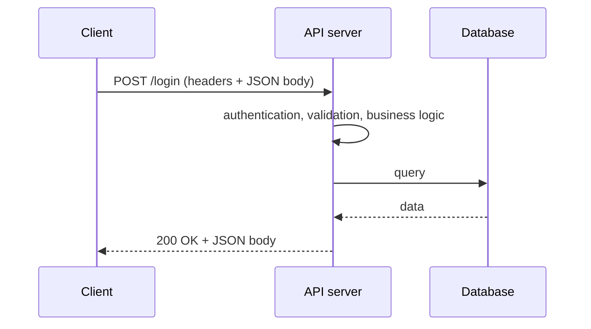

# API fundamentals

An **API (Application Programming Interface)** is the interface through which applications talk to each other and exchange data. It defines which operations are available, what data can be sent and in what format the response comes back. With APIs, systems can reuse functions of other services instead of building them from scratch.

Protocol details: [HTTP: methods, codes, headers](http.md). Access control: [Authentication and authorisation](authentication.md).

## Key terms

**API client**
:   An application or tool that sends requests to an API and receives responses, e.g. a mobile app, a website frontend, another system, or for testing [Postman](../../tools/api_testing_tools/postman.md) or Insomnia.

**Endpoint**
:   The URL of a specific resource or operation, e.g. `/users` or `/orders/42`.

**API documentation**
:   A description of endpoints, methods, parameters, authorisation and example requests and responses. Often in OpenAPI format ([Swagger](../../tools/api_testing_tools/swagger.md)). For a tester it is the main test basis.

**API lifecycle**
:   Design, implementation, testing, deployment, monitoring and maintenance of successive versions of the interface, up to retiring old versions.

## How does an API work?

An API follows the **request → response** model.

| Part | Request | Response |
|---|---|---|
| **Start line** | HTTP method and endpoint, e.g. `GET /users/42` | status code, e.g. `200 OK` |
| **Parameters** | in the path (`/users/42`) or query (`?status=active`) | |
| **Headers** | e.g. `Content-Type`, `Authorization` | e.g. `Content-Type`, `Set-Cookie` |
| **Body** | data sent to the server, e.g. a form as JSON | data or an error message |

## APIs by access

| Type | Who has access |
|---|---|
| **Private (internal)** | only systems inside the organisation, e.g. communication between microservices |
| **Partner** | selected business partners, access based on an agreement and authorisation |
| **Public** | external developers and users, often with an API key and rate limits |

## API architectures and protocols

| | REST | SOAP | GraphQL | gRPC |
|---|---|---|---|---|
| **Type** | architectural style | protocol | query language | RPC framework |
| **Data format** | usually JSON | XML | JSON | Protocol Buffers (binary) |
| **Transport** | HTTP | HTTP, SMTP and others | HTTP | HTTP/2 |
| **Endpoints** | one per resource | one per service | one for everything | service methods |
| **Contract** | OpenAPI (optional) | WSDL (required) | schema | `.proto` file |
| **Typical use** | web and mobile apps | banking, enterprise systems | frontends with flexible data needs | communication between microservices |

### REST

**REST (Representational State Transfer)** is currently the most popular style of building APIs.

- every resource has its own URL (endpoint),
- operations use standard HTTP methods: `GET`, `POST`, `PUT`, `PATCH`, `DELETE`,
- communication is **stateless**: each request carries everything the server needs to handle it,
- data is usually sent as JSON.

### SOAP

**SOAP (Simple Object Access Protocol)** is a protocol based on strictly defined XML messages (an `Envelope` with a `Header` and a `Body`).

- operations, parameters and data types are described by a **WSDL** document,
- strict standards and extensions (e.g. WS-Security) suit systems with high security requirements,
- it is heavier and harder to maintain than REST.

Testing tool: [SoapUI](../../tools/api_testing_tools/soapui.md).

### GraphQL

**GraphQL** is a query language for APIs in which **the client decides which fields it wants back**.

- a single endpoint (usually `/graphql`) handles all operations,
- operations: **Query** (read), **Mutation** (change data), **Subscription** (real-time data),
- it reduces fetching unnecessary data (overfetching) and repeated requests for missing data (underfetching).

!!! warning "Status codes in GraphQL"
    A GraphQL server often returns `200 OK` even on error and puts the details in the `errors` field of the response. In tests, check the body, not only the status code.

### gRPC

**gRPC** is a Google framework for calling methods on a remote server as if they were local functions (RPC).

- runs on HTTP/2: multiplexing, header compression, bidirectional streaming,
- data in the binary **Protocol Buffers** format, lighter than JSON,
- client and server code is generated from a `.proto` file,
- faster than REST, but harder to test with plain HTTP tools (Postman supports gRPC as a separate request type).

## API testing

API testing checks that the interface works according to the specification and is secure and performant. These tests are faster and more stable than UI tests, and they find defects earlier, often before the frontend exists.

**API-first** is an approach in which the API is designed before implementation and the application is built as a set of services exposed through APIs. The contract is available early, so tests can be written in parallel with the code.

### Types of API tests

| Type | What it checks |
|---|---|
| **Functional** | whether endpoints meet the requirements: correct data, status codes, error handling |
| **Contract** | whether requests and responses match the contract (OpenAPI, schema), i.e. whether a new version breaks integrations |
| **Single endpoint** | responses for valid, invalid and incomplete data |
| **Integration** | how the API works with the database and other services |
| **End-to-end** | a whole business process as a series of calls, e.g. sign-up → login → order |
| **Security** | access without a token, other users' resources, code injection, data leaks |
| **Performance** | response time and stability under load ([JMeter](../../tools/performance/jmeter.md)) |

### Typical defects

| Area | Examples |
|---|---|
| **Data format** | invalid JSON or XML structure, missing fields, wrong types (`"42"` instead of `42`), JSON instead of the expected XML |
| **Status codes** | `200 OK` despite an error, `500` on a validation error instead of `400`, no `404` for a missing resource |
| **Authentication and permissions** | access without a token, an expired token accepted, access to another user's data by changing the ID in the URL |
| **Input validation** | empty or too long values accepted, required fields not checked, vulnerable to SQL injection |
| **Performance and scalability** | long response times, timeouts, server errors under higher traffic |
| **Concurrency** | overwritten data, duplicate records after a double click, race conditions |
| **Security** | sensitive data or a stack trace in the response, no rate limiting, XSS in returned data |
| **CORS** | requests from the frontend blocked, or permissions too broad (`Access-Control-Allow-Origin: *`) |
| **Versioning** | a change in a new version breaks existing clients |
| **Documentation** | missing endpoints, outdated examples, documentation that does not match the API's behaviour |

### Challenges

- no user interface: the tester works with requests, responses and documentation,
- preparing test data and dependencies between calls (e.g. a token from login),
- handling authorisation, expiring tokens and different roles,
- dependence on external services that have to be replaced with mocks.

### Good practices

- test on a **separate environment** close to production, with test data instead of real data,
- always check the **status code, headers and body**, and for writes also the state in the database ([SQL](../backend/sql.md)),
- negative tests: missing fields, wrong types, no token, another user's token,
- **automate** regression tests and run them in CI,
- shared rules for all endpoints, e.g. response time below a threshold, `Content-Type: application/json`,
- test at every stage of the API lifecycle, from contract review to production monitoring.

Test examples: [API test automation](api_automation.md).
