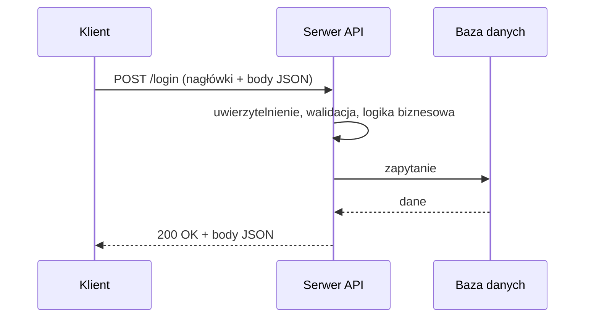

# Podstawy API

**API (Application Programming Interface)** to interfejs, przez który aplikacje komunikują się ze sobą i wymieniają dane. Określa, jakie operacje są dostępne, jakie dane można przesłać i w jakim formacie wraca odpowiedź. Dzięki API systemy mogą korzystać z gotowych funkcji innych usług zamiast pisać je od nowa.

Szczegóły protokołu: [HTTP: metody, kody, nagłówki](http.md). Mechanizmy dostępu: [Uwierzytelnianie i autoryzacja](authentication.md).

## Podstawowe pojęcia

**Klient API**
:   Aplikacja lub narzędzie, które wysyła żądania do API i odbiera odpowiedzi, np. aplikacja mobilna, frontend strony, inny system, a przy testach [Postman](../../tools/api_testing_tools/postman.md) lub Insomnia.

**Endpoint**
:   Adres URL konkretnego zasobu lub operacji, np. `/users` albo `/orders/42`.

**Dokumentacja API**
:   Opis endpointów, metod, parametrów, sposobu autoryzacji oraz przykładów żądań i odpowiedzi. Często w formacie OpenAPI ([Swagger](../../tools/api_testing_tools/swagger.md)). Dla testera to główna podstawa testów.

**Cykl życia API**
:   Projektowanie, implementacja, testowanie, wdrożenie, monitorowanie i utrzymanie kolejnych wersji interfejsu, aż do wycofania starych wersji.

## Jak działa API?

API działa w modelu **żądanie → odpowiedź** (request → response).

| Element | Żądanie (request) | Odpowiedź (response) |
|---|---|---|
| **Linia startowa** | metoda HTTP i endpoint, np. `GET /users/42` | kod statusu, np. `200 OK` |
| **Parametry** | w ścieżce (`/users/42`) lub query (`?status=active`) | |
| **Nagłówki** | np. `Content-Type`, `Authorization` | np. `Content-Type`, `Set-Cookie` |
| **Body** | dane wysyłane do serwera, np. formularz w JSON | dane lub komunikat błędu |

## API według dostępności

| Typ | Kto ma dostęp |
|---|---|
| **Private (internal)** | tylko systemy wewnątrz organizacji, np. komunikacja między mikroserwisami |
| **Partner** | wybrani partnerzy biznesowi, dostęp na podstawie umowy i autoryzacji |
| **Public** | zewnętrzni programiści i użytkownicy, często z kluczem API i limitami |

## Architektury i protokoły API

| | REST | SOAP | GraphQL | gRPC |
|---|---|---|---|---|
| **Typ** | styl architektury | protokół | język zapytań | framework RPC |
| **Format danych** | zwykle JSON | XML | JSON | Protocol Buffers (binarny) |
| **Transport** | HTTP | HTTP, SMTP i inne | HTTP | HTTP/2 |
| **Endpointy** | jeden na zasób | jeden na usługę | jeden dla wszystkiego | metody usługi |
| **Kontrakt** | OpenAPI (opcjonalnie) | WSDL (obowiązkowy) | schema | plik `.proto` |
| **Typowe zastosowanie** | aplikacje webowe i mobilne | bankowość, systemy enterprise | frontendy z elastycznymi danymi | komunikacja między mikroserwisami |

### REST

**REST (Representational State Transfer)** to obecnie najpopularniejszy styl budowania API.

- każdy zasób ma własny adres URL (endpoint),
- operacje wykonuje się standardowymi metodami HTTP: `GET`, `POST`, `PUT`, `PATCH`, `DELETE`,
- komunikacja jest **bezstanowa**: każde żądanie zawiera wszystko, czego serwer potrzebuje do jego obsługi,
- dane przesyła się zwykle w JSON.

### SOAP

**SOAP (Simple Object Access Protocol)** to protokół oparty na ściśle zdefiniowanych wiadomościach XML (koperta `Envelope` z `Header` i `Body`).

- operacje, parametry i typy danych opisuje dokument **WSDL**,
- ścisła standaryzacja i rozszerzenia (np. WS-Security) sprzyjają systemom o wysokich wymaganiach bezpieczeństwa,
- jest bardziej rozbudowany i trudniejszy w utrzymaniu niż REST.

Narzędzie do testów: [SoapUI](../../tools/api_testing_tools/soapui.md).

### GraphQL

**GraphQL** to język zapytań do API, w którym **klient sam określa, jakie pola chce otrzymać**.

- jeden endpoint (zwykle `/graphql`) obsługuje wszystkie operacje,
- operacje: **Query** (odczyt), **Mutation** (zmiana danych), **Subscription** (dane w czasie rzeczywistym),
- ogranicza pobieranie nadmiarowych danych (overfetching) i wielokrotne zapytania o brakujące dane (underfetching).

!!! warning "Kody statusu w GraphQL"
    Serwer GraphQL często zwraca `200 OK` także przy błędzie, a szczegóły umieszcza w polu `errors` odpowiedzi. W testach sprawdzaj body, nie tylko kod statusu.

### gRPC

**gRPC** to framework Google do wywoływania metod na zdalnym serwerze tak, jakby były lokalnymi funkcjami (RPC).

- działa na HTTP/2: multipleksowanie, kompresja nagłówków, dwukierunkowy streaming,
- dane w formacie binarnym **Protocol Buffers**, lżejszym niż JSON,
- kod klienta i serwera generuje się z pliku `.proto`,
- jest szybszy niż REST, ale trudniej go testować zwykłymi narzędziami HTTP (Postman obsługuje gRPC w osobnym typie żądania).

## Testowanie API

Testowanie API sprawdza, czy interfejs działa zgodnie ze specyfikacją, jest bezpieczny i wydajny. Testy są szybsze i stabilniejsze niż testy przez UI, a defekty wykrywa się wcześniej, często zanim powstanie frontend.

**API-first** to podejście, w którym API projektuje się przed implementacją, a aplikacja powstaje jako zbiór usług udostępnianych przez API. Kontrakt jest wtedy dostępny wcześnie, więc testy można pisać równolegle z kodem.

### Rodzaje testów API

| Rodzaj | Co sprawdza |
|---|---|
| **Funkcjonalne** | czy endpointy realizują wymagania: poprawne dane, kody statusu, obsługa błędów |
| **Kontraktowe** | czy żądania i odpowiedzi są zgodne z kontraktem (OpenAPI, schema), czyli czy nowa wersja nie łamie integracji |
| **Pojedynczego endpointu** | odpowiedzi dla danych poprawnych, niepoprawnych i niekompletnych |
| **Integracyjne** | współpracę API z bazą danych i innymi usługami |
| **End-to-end** | cały proces biznesowy jako seria wywołań, np. rejestracja → logowanie → zamówienie |
| **Bezpieczeństwa** | dostęp bez tokena, cudze zasoby, wstrzykiwanie kodu, wycieki danych |
| **Wydajnościowe** | czas odpowiedzi i stabilność pod obciążeniem ([JMeter](../../tools/performance/jmeter.md)) |

### Typowe defekty

| Obszar | Przykłady |
|---|---|
| **Format danych** | niepoprawna struktura JSON lub XML, brakujące pola, złe typy (`"42"` zamiast `42`), JSON zamiast oczekiwanego XML |
| **Kody statusu** | `200 OK` mimo błędu, `500` przy błędzie walidacji zamiast `400`, brak `404` dla nieistniejącego zasobu |
| **Uwierzytelnianie i uprawnienia** | dostęp bez tokena, akceptowanie wygasłego tokena, dostęp do cudzych danych po zmianie ID w URL |
| **Walidacja wejścia** | akceptowanie pustych lub zbyt długich wartości, brak sprawdzania pól wymaganych, podatność na SQL Injection |
| **Wydajność i skalowalność** | długi czas odpowiedzi, timeouty, błędy serwera przy większym ruchu |
| **Współbieżność** | nadpisywanie danych, duplikaty rekordów przy podwójnym kliknięciu, race conditions |
| **Bezpieczeństwo** | ujawnianie wrażliwych danych lub stack trace w odpowiedzi, brak limitu żądań, XSS w zwracanych danych |
| **CORS** | blokowane żądania z frontendu albo zbyt szerokie zezwolenia (`Access-Control-Allow-Origin: *`) |
| **Wersjonowanie** | zmiana w nowej wersji psuje istniejących klientów |
| **Dokumentacja** | brakujące endpointy, nieaktualne przykłady, dokumentacja niezgodna z działaniem API |

### Wyzwania

- brak interfejsu użytkownika: tester pracuje na żądaniach, odpowiedziach i dokumentacji,
- przygotowanie danych testowych i zależności między wywołaniami (np. token z logowania),
- obsługa autoryzacji, wygasających tokenów i różnych ról,
- zależność od zewnętrznych usług, które trzeba zastępować atrapami (mock).

### Dobre praktyki

- testy na **osobnym środowisku** zbliżonym do produkcyjnego, z danymi testowymi zamiast prawdziwych,
- sprawdzanie zawsze **kodu statusu, nagłówków i body**, a przy zapisie także stanu w bazie ([SQL](../backend/sql.md)),
- testy negatywne: brak pól, złe typy, brak tokena, token innego użytkownika,
- **automatyzacja** testów regresji i uruchamianie ich w CI,
- wspólne reguły dla wszystkich endpointów, np. czas odpowiedzi poniżej progu, `Content-Type: application/json`,
- testowanie na każdym etapie cyklu życia API, od przeglądu kontraktu po monitoring produkcji.

Przykłady testów: [Automatyzacja testów API](api_automation.md).
