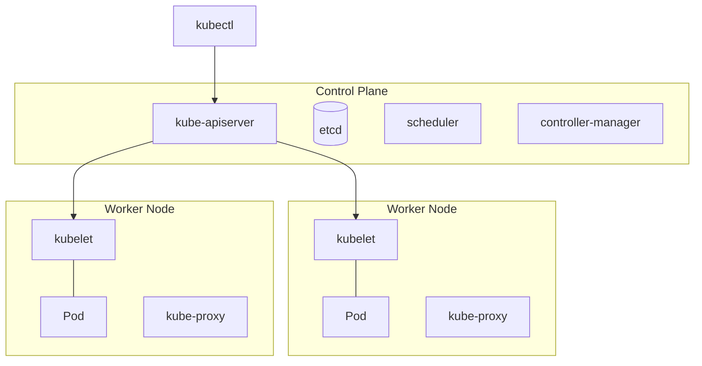

# Kubernetes

**Kubernetes (K8s)** is an open-source platform for **container orchestration**. It automates deploying, scaling and managing containerised applications. It runs as a **cluster**, i.e. a group of connected physical or virtual machines.

## Main features

- **Scalability**: containers are added and removed automatically depending on load,
- **Self-healing**: when a container fails, a new one is started automatically,
- **Portability**: the same configuration locally, in the cloud and on-premise,
- **Automation**: deployments and updates without manual work (e.g. rolling update).

## Cluster architecture

| Component | Role |
|---|---|
| **kube-apiserver** | the main API that components and `kubectl` communicate through |
| **etcd** | distributed key–value store holding the state of the whole cluster |
| **scheduler** | decides which node a new Pod runs on |
| **controller-manager** | watches the cluster state and reacts to changes (e.g. restart after a failure) |
| **kubelet** | agent on every node, starts and monitors containers |
| **kube-proxy** | handles network traffic between services |
| **container runtime** | the engine that runs containers (e.g. containerd) |

## Key objects

| Object | Description |
|---|---|
| **Pod** | the smallest unit, usually one container. Testers read its logs |
| **Deployment** | how many copies of the application should run and how to update it |
| **ReplicaSet** | keeps the number of running Pods in check |
| **Service** | communication between Pods and exposing the application (e.g. an API) |
| **Namespace** | logical division of the cluster, e.g. `dev`, `qa`, `prod` |
| **ConfigMap / Secret** | configuration / sensitive data (passwords, tokens) |
| **Ingress** | exposing HTTP(S) services outside the cluster |

## `kubectl` commands useful for testers

| Command | Description |
|---|---|
| `kubectl get pods -n qa` | list of pods in the `qa` namespace |
| `kubectl logs <pod> -n qa` | pod logs (investigating failures) |
| `kubectl logs <pod> -n qa --previous` | logs of the previous container when the pod keeps restarting |
| `kubectl rollout status deployment/<name> -n qa` | whether the rollout of a new version has finished |
| `kubectl port-forward svc/<service> 8080:80 -n qa` | reach a service from your own machine at `localhost:8080` |
| `kubectl describe pod <pod> -n qa` | details, e.g. the reason for a crash |
| `kubectl get events -n qa --sort-by=.lastTimestamp` | events from oldest to newest, diagnosing deployment problems |
| `kubectl get deployments -n qa` | list of deployments |
| `kubectl get svc -n qa` | list of services |
| `kubectl apply -f deployment.yaml -n qa` | create / update objects from YAML |
| `kubectl delete pod <pod> -n qa` | delete a pod (the deployment recreates it automatically) |

| Pod status | Typical cause |
|---|---|
| `Pending` | not enough resources in the cluster or an unbound volume |
| `ImagePullBackOff` | wrong image name or tag, no access to the registry |
| `CrashLoopBackOff` | the app exits right after starting, e.g. a missing environment variable; check `logs --previous` |

## A tester's workflow

1. DevOps deploys a new version to the `qa` namespace.
2. The tester checks the deployment: `kubectl get pods -n qa` (status `Running`, no restarts).
3. Runs automated tests (e.g. an API collection in Postman or Newman).
4. If tests fail, fetches the logs: `kubectl logs <pod> -n qa`.
5. Reports the defect in Jira **with the logs and the pod name**, DevOps / a developer investigates the cause.
6. After the fix: retest and regression testing.
