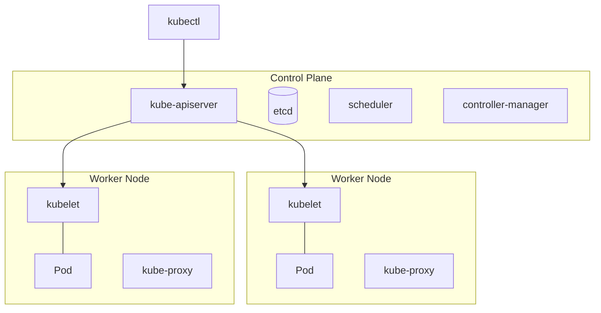

# Kubernetes

**Kubernetes (K8s)** to platforma open source do **orkiestracji kontenerów**. Automatyzuje wdrażanie, skalowanie i zarządzanie aplikacjami w kontenerach. Działa w formie **klastra**, czyli grupy połączonych maszyn fizycznych lub wirtualnych.

## Główne cechy

- **Skalowalność**: automatyczne dodawanie i usuwanie kontenerów zależnie od obciążenia,
- **Samonaprawianie**: po awarii kontenera automatycznie uruchamiany jest nowy,
- **Przenośność**: ta sama konfiguracja lokalnie, w chmurze i on-premise,
- **Automatyzacja**: wdrożenia i aktualizacje bez ręcznej pracy (np. rolling update).

## Architektura klastra

| Komponent | Rola |
|---|---|
| **kube-apiserver** | główny interfejs API, przez który komunikują się komponenty i `kubectl` |
| **etcd** | rozproszona baza klucz–wartość ze stanem całego klastra |
| **scheduler** | decyduje, na którym węźle uruchomić nowy Pod |
| **controller-manager** | pilnuje stanu klastra i reaguje na zmiany (np. restart po awarii) |
| **kubelet** | agent na każdym węźle, uruchamia i monitoruje kontenery |
| **kube-proxy** | obsługuje ruch sieciowy między usługami |
| **container runtime** | silnik uruchamiający kontenery (np. containerd) |

## Kluczowe obiekty

| Obiekt | Opis |
|---|---|
| **Pod** | najmniejsza jednostka, zwykle jeden kontener. Tester analizuje jego logi |
| **Deployment** | ile kopii aplikacji ma działać i jak ją aktualizować |
| **ReplicaSet** | pilnuje liczby działających Podów |
| **Service** | komunikacja między Podami i wystawienie aplikacji (np. API) |
| **Namespace** | logiczny podział klastra, np. `dev`, `qa`, `prod` |
| **ConfigMap / Secret** | konfiguracja / dane wrażliwe (hasła, tokeny) |
| **Ingress** | wystawienie usług HTTP(S) na zewnątrz klastra |

## Komendy `kubectl` przydatne testerowi

| Komenda | Opis |
|---|---|
| `kubectl get pods -n qa` | lista Podów w namespace `qa` |
| `kubectl logs <pod> -n qa` | logi Poda (analiza błędów) |
| `kubectl logs <pod> -n qa --previous` | logi poprzedniego kontenera, gdy Pod się restartuje |
| `kubectl rollout status deployment/<nazwa> -n qa` | czy wdrożenie nowej wersji się zakończyło |
| `kubectl port-forward svc/<usługa> 8080:80 -n qa` | dostęp do usługi z własnego komputera na `localhost:8080` |
| `kubectl describe pod <pod> -n qa` | szczegóły, np. przyczyna awarii |
| `kubectl get events -n qa --sort-by=.lastTimestamp` | zdarzenia od najstarszego, diagnoza problemów z wdrożeniem |
| `kubectl get deployments -n qa` | lista deploymentów |
| `kubectl get svc -n qa` | lista usług |
| `kubectl apply -f deployment.yaml` | utworzenie / aktualizacja obiektów z YAML |
| `kubectl delete pod <pod>` | usunięcie Poda (Deployment odtworzy go automatycznie) |

| Status Poda | Typowa przyczyna |
|---|---|
| `Pending` | brak zasobów w klastrze albo nieprzypisany wolumen |
| `ImagePullBackOff` | zła nazwa lub tag obrazu, brak dostępu do rejestru |
| `CrashLoopBackOff` | aplikacja kończy działanie zaraz po starcie, np. brak zmiennej środowiskowej; sprawdź `logs --previous` |

## Scenariusz pracy testera

1. DevOps wdraża nową wersję do namespace `qa`.
2. Tester sprawdza wdrożenie: `kubectl get pods -n qa` (status `Running`, brak restartów).
3. Uruchamia testy automatyczne (np. kolekcję API w Postmanie lub Newmanie).
4. Gdy testy nie przechodzą, pobiera logi: `kubectl logs <pod> -n qa`.
5. Zgłasza defekt w Jirze **z logami i nazwą Poda**, DevOps lub programista analizuje przyczynę.
6. Po poprawce: retest i testy regresji.
