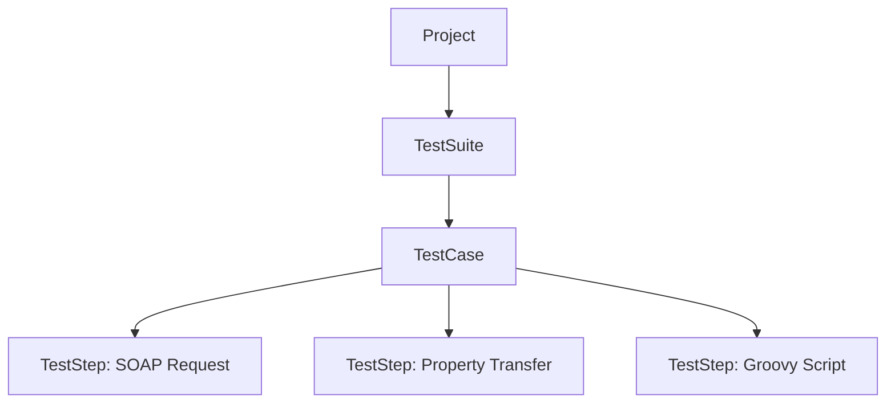

# SoapUI

**SoapUI** is an open-source tool (SmartBear) for testing **SOAP** and **REST** web services. The extended commercial version is **ReadyAPI**.

## When to use SoapUI?

- testing **SOAP** APIs: importing a **WSDL** file automatically generates requests for all operations,
- corporate, banking and insurance systems, where SOAP is still popular,
- functional, **data-driven** and simple load tests in one tool.

## Project structure



## Assertions

| Assertion | Checks |
|---|---|
| **Contains / Not Contains** | whether the response contains a text |
| **XPath Match** | the value of an XML node |
| **JSONPath Match** | the value of a JSON field |
| **Valid HTTP Status Codes** | the status code |
| **SOAP Response / Not SOAP Fault** | whether the SOAP response is valid |
| **Schema Compliance** | compliance with the WSDL / XSD schema |
| **Response SLA** | response time |

## Sample SOAP request

```xml
<soapenv:Envelope xmlns:soapenv="http://schemas.xmlsoap.org/soap/envelope/"
                  xmlns:web="http://example.com/webservice">
  <soapenv:Header/>
  <soapenv:Body>
    <web:GetUser>
      <web:UserId>42</web:UserId>
    </web:GetUser>
  </soapenv:Body>
</soapenv:Envelope>
```

## SoapUI vs Postman

| | SoapUI | Postman |
|---|---|---|
| SOAP / WSDL | native | basic |
| REST | basic | full support |
| Scripts | Groovy | JavaScript |
| Load tests | basic (LoadUI in ReadyAPI) | limited |
| Learning curve | steeper | gentler |
