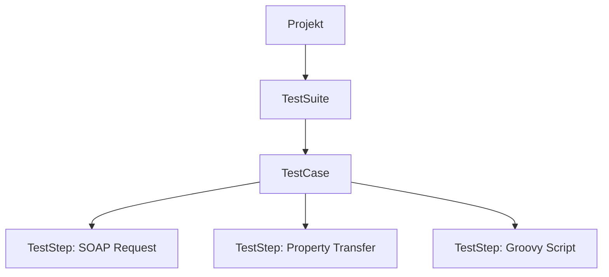

# SoapUI

**SoapUI** to narzędzie open source (SmartBear) do testowania usług sieciowych **SOAP** i **REST**. Komercyjna, rozbudowana wersja to **ReadyAPI**.

## Kiedy SoapUI?

- testowanie API **SOAP**: import pliku **WSDL** automatycznie generuje requesty dla wszystkich operacji,
- systemy korporacyjne, bankowe i ubezpieczeniowe, gdzie SOAP jest nadal popularny,
- testy funkcjonalne, **data-driven** i proste testy obciążeniowe w jednym narzędziu.

## Struktura projektu



## Asercje

| Asercja | Sprawdza |
|---|---|
| **Contains / Not Contains** | czy odpowiedź zawiera tekst |
| **XPath Match** | wartość węzła XML |
| **JSONPath Match** | wartość pola JSON |
| **Valid HTTP Status Codes** | kod odpowiedzi |
| **SOAP Response / Not SOAP Fault** | poprawność odpowiedzi SOAP |
| **Schema Compliance** | zgodność z WSDL / schematem XSD |
| **Response SLA** | czas odpowiedzi |

## Przykładowe żądanie SOAP

```xml
<soapenv:Envelope xmlns:soapenv="http://schemas.xmlsoap.org/soap/envelope/"
                  xmlns:web="http://example.com/webservice">
  <soapenv:Header/>
  <soapenv:Body>
    <web:GetUser>
      <web:UserId>42</web:UserId>
    </web:GetUser>
  </soapenv:Body>
</soapenv:Envelope>
```

## SoapUI a Postman

| | SoapUI | Postman |
|---|---|---|
| SOAP / WSDL | natywnie | podstawowo |
| REST | podstawowo | pełne wsparcie |
| Skrypty | Groovy | JavaScript |
| Testy obciążeniowe | podstawowe (LoadUI w ReadyAPI) | ograniczone |
| Krzywa nauki | wyższa | niższa |
