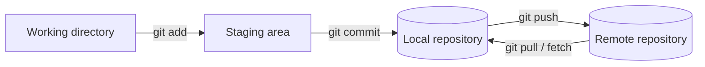

# Git basics

## Git, GitHub and GitHub Desktop

<div class="grid cards" markdown>

-   **Git: the engine**

    ---

    A local **version control system**. It works on your computer without the internet, remembers the history of changes (commits), lets you create branches and merge code. It keeps its data in the hidden `.git` folder.

-   **GitHub: the cloud**

    ---

    A hosting platform for Git repositories. It enables collaboration, **pull requests**, issues, GitHub Actions and GitHub Pages.

-   **GitHub Desktop / GitKraken: GUI**

    ---

    Graphical front-ends for Git. Under the hood they run the same commands you can type in the terminal.

</div>

## The three areas of Git



## Most important commands

| Command | Description |
|---|---|
| `git clone <url>` | download a repository |
| `git status` | state of changes |
| `git add <file>` / `git add .` | add changes to staging |
| `git commit -m "message"` | save changes in the history |
| `git push` | send commits to the server |
| `git pull` | fetch and merge changes from the server |
| `git fetch` | fetch changes without merging |
| `git log --oneline` | commit history |
| `git diff` | differences in files |
| `git branch` | list of branches |
| `git switch -c <name>` | create a new branch and switch to it |
| `git switch <name>` | switch branches |
| `git merge <branch>` | merge a branch |
| `git stash` / `git stash pop` | put aside and restore uncommitted changes |

## Typical workflow

```bash
git switch main && git pull
git switch -c feature/login-tests
# ... changes ...
git add .
git commit -m "Add login tests"
git push -u origin feature/login-tests
# then a pull request on GitHub and code review
```

!!! tip "Good commits"
    A short message in the imperative mood (*Add…*, *Fix…*), one commit = one logical change. Messages like `com` or `sd` mean nothing after a while.

## When something goes wrong

| Situation | Command |
|---|---|
| I want to undo changes in a file I have not added yet | `git restore <file>` |
| I added a file to staging by mistake | `git restore --staged <file>` |
| I want to fix the message of the last commit (not pushed yet) | `git commit --amend -m "New message"` |
| I want to undo a commit that is already on the server | `git revert <hash>`: creates a new commit that reverses the changes, without rewriting history |
| I need to switch branches quickly, but have uncommitted changes | `git stash`, then `git stash pop` |

!!! warning "Careful with history"
    `git reset --hard` and `git push --force` delete changes or overwrite history on the server. Do not use them on shared branches such as `main`.

### Merge conflict

A conflict happens when two people changed the same lines of a file. Git stops the merge and marks the conflict:

```text
<<<<<<< HEAD
const timeout = 5000;
=======
const timeout = 10000;
>>>>>>> feature/longer-timeout
```

1. Open the file and decide which version is correct (or combine both). If in doubt, ask the author of the other change.
2. Remove the `<<<<<<<`, `=======` and `>>>>>>>` markers.
3. `git add <file>`, then `git commit` (for `git merge`) or `git rebase --continue` (for a rebase).
4. Run the tests before you push.

## Git in a tester's work

- keeping automated tests and Postman collections together with the code,
- reviewing changes in pull requests (what exactly changed, i.e. what to test),
- running tests on a specific branch or version,
- `.gitignore` for files that are not versioned (e.g. `node_modules`, reports, secrets).
