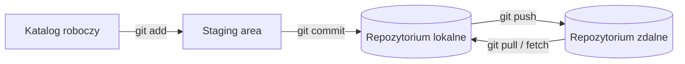

# Podstawy Git

## Git, GitHub i GitHub Desktop

<div class="grid cards" markdown>

-   **Git: silnik**

    ---

    Lokalny **system kontroli wersji**. Działa na twoim komputerze bez internetu, zapamiętuje historię zmian (commity), pozwala tworzyć gałęzie i łączyć kod. Dane trzyma w ukrytym folderze `.git`.

-   **GitHub: chmura**

    ---

    Platforma hostingowa dla repozytoriów Git. Umożliwia współpracę, **Pull Requesty**, Issues, GitHub Actions i GitHub Pages.

-   **GitHub Desktop / GitKraken: GUI**

    ---

    Graficzne nakładki na Gita. Pod spodem wykonują te same komendy, które można wpisać w terminalu.

</div>

## Trzy obszary Gita



## Najważniejsze komendy

| Komenda | Opis |
|---|---|
| `git clone <url>` | pobranie repozytorium |
| `git status` | stan zmian |
| `git add <plik>` / `git add .` | dodanie zmian do staging |
| `git commit -m "opis"` | zapisanie zmian w historii |
| `git push` | wysłanie commitów na serwer |
| `git pull` | pobranie i scalenie zmian z serwera |
| `git fetch` | pobranie zmian bez scalania |
| `git log --oneline` | historia commitów |
| `git diff` | różnice w plikach |
| `git branch` | lista gałęzi |
| `git switch -c <nazwa>` | nowa gałąź i przełączenie |
| `git switch <nazwa>` | przełączenie gałęzi |
| `git merge <gałąź>` | scalenie gałęzi |
| `git stash` / `git stash pop` | odłożenie i przywrócenie niezacommitowanych zmian |

## Typowy workflow

```bash
git switch main && git pull
git switch -c feature/testy-logowania
# ... zmiany ...
git add .
git commit -m "Dodaj testy logowania"
git push -u origin feature/testy-logowania
# następnie Pull Request na GitHubie i code review
```

!!! tip "Dobre commity"
    Krótki opis w trybie rozkazującym (*Dodaj…*, *Popraw…*), jeden commit = jedna logiczna zmiana. Komunikaty typu `com`, `sd` nic nie mówią po czasie.

## Gdy coś pójdzie nie tak

| Sytuacja | Polecenie |
|---|---|
| chcę cofnąć zmiany w pliku, którego jeszcze nie dodałem | `git restore <plik>` |
| dodałem plik do staging przez pomyłkę | `git restore --staged <plik>` |
| chcę poprawić opis ostatniego commita (jeszcze niewypchniętego) | `git commit --amend -m "Nowy opis"` |
| chcę wycofać commit, który jest już na serwerze | `git revert <hash>`: tworzy nowy commit odwracający zmiany, nie zmienia historii |
| muszę szybko przełączyć gałąź, a mam niezacommitowane zmiany | `git stash`, potem `git stash pop` |

!!! warning "Ostrożnie z historią"
    Polecenia `git reset --hard` i `git push --force` usuwają zmiany lub nadpisują historię na serwerze. Na wspólnych gałęziach, np. `main`, ich nie używaj.

### Konflikt przy scalaniu

Konflikt pojawia się, gdy dwie osoby zmieniły te same linie pliku. Git zatrzymuje scalanie i oznacza miejsce konfliktu:

```text
<<<<<<< HEAD
const timeout = 5000;
=======
const timeout = 10000;
>>>>>>> feature/dluzszy-timeout
```

1. Otwórz plik i zdecyduj, która wersja jest poprawna (albo połącz obie). W razie wątpliwości zapytaj autora drugiej zmiany.
2. Usuń znaczniki `<<<<<<<`, `=======` i `>>>>>>>`.
3. `git add <plik>`, a potem `git commit` (przy `git merge`) albo `git rebase --continue` (przy rebase).
4. Uruchom testy, zanim wypchniesz zmiany.

## Git w pracy testera

- przechowywanie testów automatycznych i kolekcji Postmana razem z kodem,
- przegląd zmian w Pull Requestach (co dokładnie zostało zmienione, czyli co testować),
- uruchamianie testów na konkretnej gałęzi lub wersji,
- `.gitignore` dla plików, których nie należy wersjonować (np. `node_modules`, raporty, sekrety).
