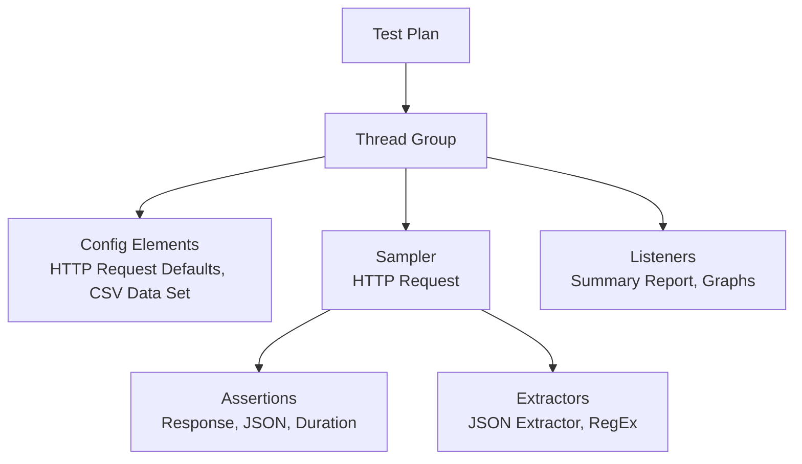

# Apache JMeter

**Apache JMeter** is a free tool (Java) for creating, running and analysing **performance tests**. It lets you test the performance of endpoints and whole APIs (various HTTP methods), as well as databases, FTP and other protocols.

Theory: [Performance testing](../../fundamentals/performance_testing.md)

## Test plan elements



| Element | Role |
|---|---|
| **Thread Group** | number of virtual users, ramp-up time, number of loops, behaviour after an error |
| **Sampler** | what is sent and where (e.g. an HTTP Request to a chosen server) |
| **Config Elements** | shared settings, data from CSV, variables (similar to Postman) |
| **Assertions** | verifying the response: code, content, time |
| **JSON Assertion** | checking any property of a JSON response, e.g. after sending a POST |
| **Extractors** | extracting values (e.g. a token) into variables |
| **Listeners** | results: tables, charts, reports |

## Running

!!! warning "GUI only for creating tests"
    Real load tests are run in **CLI** mode, because the GUI uses a lot of resources and skews the results.

```bash
jmeter -n -t plan.jmx -l results.jtl -e -o html_report/
```

- `-n` non-GUI mode, `-t` test plan, `-l` results file, `-e -o` generate an HTML report (the `-o` directory must not exist or must be empty, otherwise JMeter reports an error).

## Analysing results

Key columns in the *Summary / Aggregate Report*:

- **Average / Median / 90% / 95% / 99% Line**: response times,
- **Throughput**: requests per second,
- **Error %**: percentage of errors.

Results can be streamed live to **InfluxDB + [Grafana](../monitoring/grafana.md)** (Backend Listener).

!!! tip "A lighter alternative"
    **oha** (GitHub) is a lightweight CLI tool for quickly loading a single endpoint when JMeter is too heavy.
