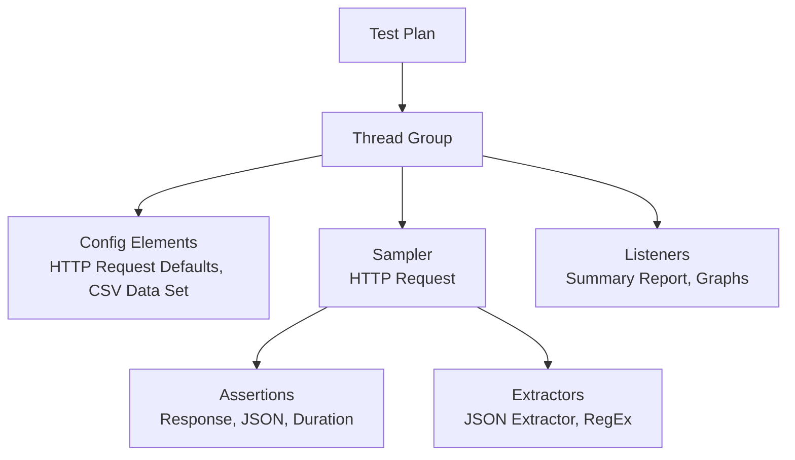

# Apache JMeter

**Apache JMeter** to darmowe narzędzie (Java) do tworzenia, uruchamiania i analizowania **testów wydajnościowych**. Pozwala testować wydajność endpointów i całych API (różne metody HTTP), a także baz danych, FTP i innych protokołów.

Teoria: [Testy wydajnościowe](../../fundamentals/performance_testing.md)

## Elementy planu testu



| Element | Rola |
|---|---|
| **Thread Group** | liczba wirtualnych użytkowników, czas rozbiegu (ramp-up), liczba powtórzeń, zachowanie po błędzie |
| **Sampler** | co wysyłamy i dokąd (np. HTTP Request na wybrany serwer) |
| **Config Elements** | wspólne ustawienia, dane z CSV, zmienne (podobnie jak w Postmanie) |
| **Assertions** | weryfikacja odpowiedzi: kod, treść, czas |
| **JSON Assertion** | sprawdzenie dowolnej właściwości odpowiedzi JSON, np. po wysłaniu POST |
| **Extractors** | wyciąganie wartości (np. tokenu) do zmiennych |
| **Listeners** | wyniki: tabele, wykresy, raporty |

## Uruchamianie

!!! warning "GUI tylko do tworzenia testów"
    Właściwe testy obciążeniowe uruchamia się w trybie **CLI**, bo GUI zużywa dużo zasobów i zaniża wyniki.

```bash
jmeter -n -t plan.jmx -l wyniki.jtl -e -o raport_html/
```

- `-n` tryb bez GUI, `-t` plan testu, `-l` plik wyników, `-e -o` wygenerowanie raportu HTML (katalog z `-o` musi nie istnieć lub być pusty, inaczej JMeter zgłosi błąd).

## Analiza wyników

Kluczowe kolumny w *Summary / Aggregate Report*:

- **Average / Median / 90% / 95% / 99% Line**: czasy odpowiedzi,
- **Throughput**: liczba żądań na sekundę,
- **Error %**: procent błędów.

Wyniki można wysyłać na żywo do **InfluxDB + [Grafana](../monitoring/grafana.md)** (Backend Listener).

!!! tip "Lżejsza alternatywa"
    **oha** (GitHub) to lekkie narzędzie CLI do szybkiego obciążenia pojedynczego endpointu, gdy JMeter jest zbyt ciężki.
