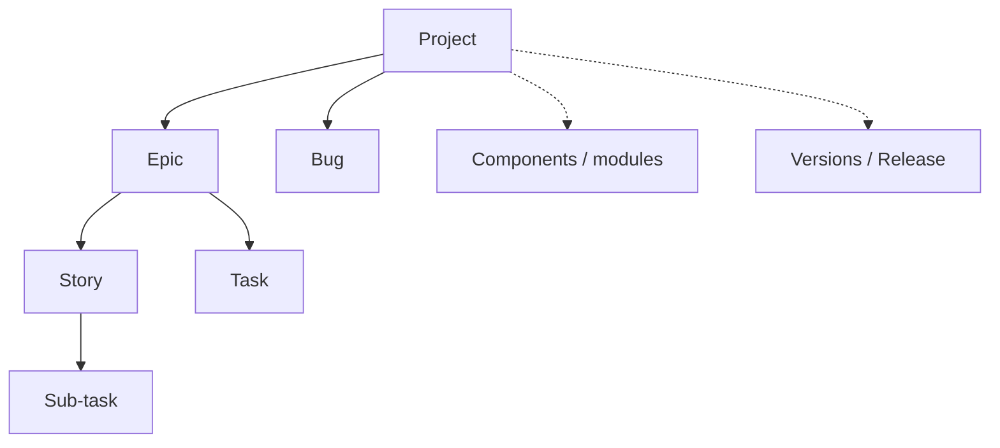
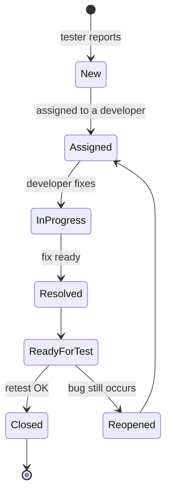

# Jira

**Jira** (Atlassian) is a platform for organising work and running and monitoring team processes. It supports **Scrum** and **Kanban** boards, sprint planning and integrations with other tools. It is used by testers, developers, analysts, DevOps, Project Managers and Product Owners.

## Work structure



- A **project** has a person responsible for it, and issues with different priorities are created inside it.
- **Components** group tasks from one module.
- **Versions (Release)** are points in time to which issues are assigned.

## Issue types

| Type | Description |
|---|---|
| **Epic** | a larger feature covering many Stories and Tasks |
| **Story** | a feature from the user's perspective: *“As a user I want…”* |
| **Task** | a technical task, e.g. configuring an environment |
| **Bug** | a defect in the application, most often reported by testers |
| **Sub-task** | a smaller piece of work within a parent issue, e.g. tests or documentation |

Each issue has a unique key, e.g. `QA-123`.

## Main modules

| Module | Purpose | What the tester gets from it |
|---|---|---|
| **Dashboard** | quick status overview (widgets) | how many bugs await retest, whether the sprint end is approaching |
| **Backlog** | tasks waiting to be planned | insight into upcoming features, early static testing |
| **Board** | visualisation of the workflow | tasks in the *Ready for Test* column |
| **Reports** | progress analysis | number of open and closed bugs in the sprint |
| **Filters** | searching by criteria (JQL) | saved views, e.g. “my bugs to retest” |

A sample board workflow:

**To Do → In Progress → Code Review → Ready for Test → In Testing → Done**

## Reports

- **Burndown Chart**: the pace of sprint completion,
- **Velocity Chart**: how many points the team completes per sprint on average,
- **Cumulative Flow Diagram**: the flow of tasks through statuses (bottlenecks).

## JQL: useful queries

```sql
-- my active tasks
assignee = currentUser() AND status != Done

-- bugs to retest
project = QA AND issuetype = Bug AND status = "Ready for Test"

-- critical bugs from the last 7 days
issuetype = Bug AND priority in (Highest, High) AND created >= -7d ORDER BY priority DESC
```

Filters can be saved and shared with the team.

## Bug lifecycle



## Roles in Jira

| Role | Responsibilities |
|---|---|
| **Tester (QA)** | reports bugs, fills in reproduction steps, performs retests, changes statuses (*Ready for Test → Closed / Reopened*) |
| **Developer** | picks up tasks, fixes bugs, sets *Resolved* |
| **Product Owner / Analyst** | creates and describes User Stories, sets priorities, accepts tasks |
| **Scrum Master / PM** | monitors the sprint, removes blockers, grooms the backlog |
| **DevOps** | tracks deployments and builds, links commits to tasks |

## A practical team flow

1. The PO / analyst creates a User Story, e.g. *“User login”*.
2. The developer implements it and changes the status to **Ready for Test**.
3. The tester tests it. When they find a bug, they create a **Bug** linked to the Story.
4. The developer fixes it and sets **Resolved**.
5. The tester retests: **Closed** or **Reopened**.
6. At the end of the sprint the team reviews the bug report and velocity.

## Additional features

- **Linking issues** (Bug → Story, Story → Epic),
- **Watchers**: people who receive notifications,
- **Automation Rules**, e.g. changing the status after a merge,
- integrations: [TestLink](testlink.md), [Xray](xray.md), [Jenkins](../ci_cd/jenkins.md), [Confluence](../collaboration/confluence.md), [Slack](../collaboration/slack.md).
