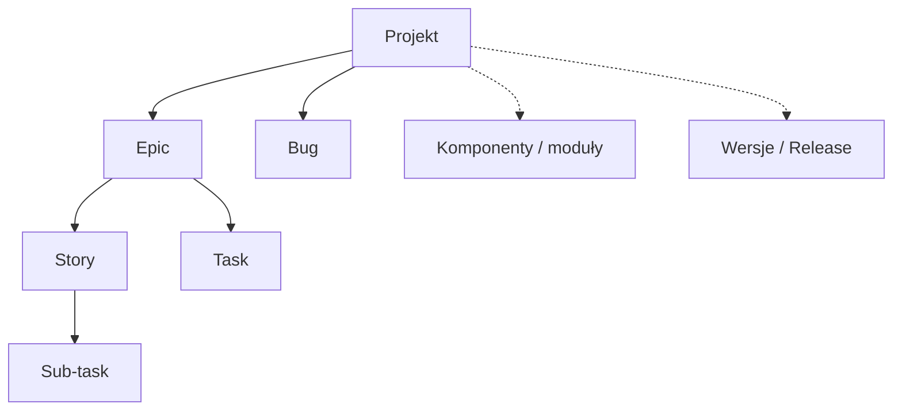
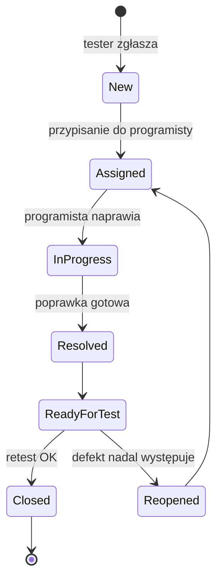

# Jira

**Jira** (Atlassian) to platforma do organizowania pracy oraz uruchamiania i monitorowania procesów w zespole. Obsługuje tablice **Scrum** i **Kanban**, planowanie sprintów i integracje z innymi narzędziami. Używają jej testerzy, programiści, analitycy, DevOps, Project Managerowie i Product Ownerzy.

## Struktura pracy



- **Projekt** ma osobę odpowiedzialną, a w nim tworzy się zgłoszenia (Issues) o różnych priorytetach.
- **Komponenty** grupują zadania z jednego modułu.
- **Wersje (Release)** to punkty w czasie, do których przypisuje się zgłoszenia.

## Typy zgłoszeń

| Typ | Opis |
|---|---|
| **Epic** | większa funkcjonalność obejmująca wiele Story i Tasków |
| **Story** | funkcjonalność z perspektywy użytkownika: *„Jako użytkownik chcę…”* |
| **Task** | zadanie techniczne, np. konfiguracja środowiska |
| **Bug** | defekt w aplikacji, najczęściej zgłaszany przez testerów |
| **Sub-task** | podzadanie, np. testy lub dokumentacja w ramach większego zadania |

Każde zgłoszenie ma unikalny klucz, np. `QA-123`.

## Główne moduły

| Moduł | Cel | Co ma z tego tester |
|---|---|---|
| **Dashboard** | szybki przegląd statusu (widżety) | ile defektów do retestu, czy zbliża się koniec sprintu |
| **Backlog** | zadania czekające na zaplanowanie | wgląd w nadchodzące funkcjonalności, wczesne testowanie statyczne |
| **Board** | wizualizacja przepływu pracy | zadania w kolumnie *Ready for Test* |
| **Reports** | analiza postępu | liczba defektów otwartych i zamkniętych w sprincie |
| **Filters** | wyszukiwanie po kryteriach (JQL) | zapisane widoki, np. „moje defekty do retestu” |

Przykładowy workflow tablicy:

**To Do → In Progress → Code Review → Ready for Test → In Testing → Done**

## Raporty

- **Burndown Chart**: tempo realizacji sprintu,
- **Velocity Chart**: ile punktów zespół średnio realizuje w sprincie,
- **Cumulative Flow Diagram**: przepływ zadań przez statusy (wąskie gardła).

## JQL: przydatne zapytania

```sql
-- moje aktywne zadania
assignee = currentUser() AND status != Done

-- defekty do retestu
project = QA AND issuetype = Bug AND status = "Ready for Test"

-- krytyczne defekty z ostatnich 7 dni
issuetype = Bug AND priority in (Highest, High) AND created >= -7d ORDER BY priority DESC
```

Filtry można zapisywać i udostępniać zespołowi.

## Cykl życia defektu (Bug lifecycle)



## Role w Jirze

| Rola | Zakres działań |
|---|---|
| **Tester (QA)** | zgłasza defekty, uzupełnia kroki do odtworzenia, wykonuje retesty, zmienia statusy (*Ready for Test → Closed / Reopened*) |
| **Developer** | przypisuje się do zadań, naprawia defekty, ustawia *Resolved* |
| **Product Owner / Analityk** | tworzy i opisuje User Stories, ustala priorytety, akceptuje zadania |
| **Scrum Master / PM** | monitoruje sprint, usuwa blokery, porządkuje backlog |
| **DevOps** | śledzi deploymenty i buildy, łączy commity z zadaniami |

## Praktyczny przepływ w zespole

1. PO / analityk tworzy User Story, np. *„Logowanie użytkownika”*.
2. Developer implementuje i zmienia status na **Ready for Test**.
3. Tester testuje. Gdy znajdzie defekt, tworzy **Bug** powiązany ze Story.
4. Developer naprawia i ustawia **Resolved**.
5. Tester robi retest: **Closed** albo **Reopened**.
6. Na koniec sprintu zespół przegląda raport defektów i velocity.

## Dodatkowe funkcje

- **Linkowanie zgłoszeń** (Bug → Story, Story → Epic),
- **Watchers**: obserwatorzy otrzymujący powiadomienia,
- **Automation Rules**, np. zmiana statusu po merge'u,
- integracje: [TestLink](testlink.md), [Xray](xray.md), [Jenkins](../ci_cd/jenkins.md), [Confluence](../collaboration/confluence.md), [Slack](../collaboration/slack.md).
