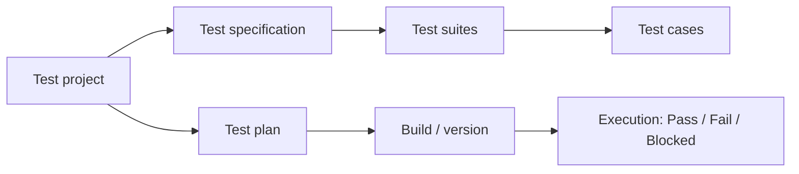

# TestLink

**TestLink** is an open-source, browser-based **test management** tool. It supports test cases, test suites, test plans, test projects, user management and reports. It integrates with [Jira](jira.md) and other bug trackers.

## Structure

| Element | Description |
|---|---|
| **Test Project** | the top level, usually one product |
| **Test Specification** | the tree of test suites and test cases |
| **Test Case** | steps, expected results, preconditions, priority |
| **Test Plan** | the cases selected for execution in a given cycle |
| **Build** | a specific version of the application the plan is executed on |
| **Requirements** | requirements linked to test cases (requirements coverage) |

## Use cases

- a central repository of test cases,
- tracking execution progress across builds,
- reports: results per build, requirements coverage, bugs,
- when a test fails: creating a Jira issue directly from TestLink.

!!! warning "Project maintenance"
    TestLink is developed very slowly (the latest releases are several years old), so new projects more often choose Xray, Zephyr, TestRail or qTest. It is still worth knowing because older projects keep using it.

!!! info "Alternatives"
    [Xray](xray.md) and Zephyr (Jira plugins), TestRail, qTest.
