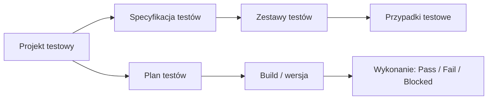

# TestLink

**TestLink** to narzędzie open source do **zarządzania testami** działające w przeglądarce. Obsługuje przypadki testowe, zestawy testów, plany testów, projekty testowe, zarządzanie użytkownikami oraz raporty. Integruje się z [Jirą](jira.md) i innymi bug trackerami.

## Struktura

| Element | Opis |
|---|---|
| **Test Project** | najwyższy poziom, zwykle jeden produkt |
| **Test Specification** | drzewo zestawów i przypadków testowych |
| **Test Case** | kroki, wyniki oczekiwane, warunki wstępne, priorytet |
| **Test Plan** | wybrane przypadki do wykonania w danym cyklu |
| **Build** | konkretna wersja aplikacji, na której wykonujemy plan |
| **Requirements** | wymagania powiązane z przypadkami (pokrycie wymagań) |

## Zastosowanie

- centralne repozytorium przypadków testowych,
- śledzenie postępu wykonania w kolejnych buildach,
- raporty: wyniki per build, pokrycie wymagań, defekty,
- przy niezaliczonym teście: utworzenie zgłoszenia w Jirze bezpośrednio z TestLinka.

!!! warning "Utrzymanie projektu"
    TestLink jest rozwijany bardzo wolno (ostatnie wydania pochodzą sprzed kilku lat), więc w nowych projektach częściej wybiera się Xray, Zephyr, TestRail lub qTest. Warto go znać, bo nadal bywa używany w starszych projektach.

!!! info "Alternatywy"
    [Xray](xray.md) i Zephyr (wtyczki do Jiry), TestRail, qTest.
