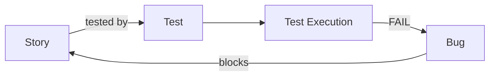

# Xray

**Xray** is a test management tool that works **inside [Jira](jira.md)** (an app from the Atlassian Marketplace). It is an alternative to [TestLink](testlink.md). Tests, plans and results are regular Jira issues, so everything is in one place.

## Xray issue types

In Jira you create the appropriate issue types and map them to Xray:

| Type | Description |
|---|---|
| **Test** | a test case: manual (steps), Cucumber (Gherkin) or generic (automated) |
| **Precondition** | preconditions shared by many tests |
| **Test Set** | a logical group of tests (e.g. “Cart regression”) |
| **Test Plan** | tests planned for execution for a version or sprint |
| **Test Execution** | a specific run of tests with results |

## Benefits

- **traceability**: Story ↔ Test ↔ Execution ↔ Bug,
- requirements coverage reports directly in Jira,
- importing **automated test** results (JUnit, Cypress, Robot Framework, Cucumber) via the REST API or CI,
- **BDD** support: Gherkin scenarios as tests.

