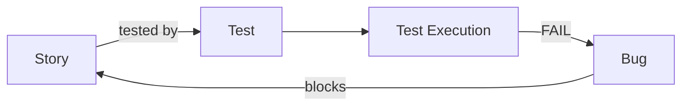

# Xray

**Xray** to narzędzie do zarządzania testami działające **wewnątrz [Jiry](jira.md)** (aplikacja z Atlassian Marketplace). Jest alternatywą dla [TestLinka](testlink.md). Testy, plany i wyniki są zwykłymi zgłoszeniami Jiry, więc wszystko jest w jednym miejscu.

## Typy zgłoszeń Xray

W Jirze tworzy się odpowiednie typy zgłoszeń i mapuje je do Xraya:

| Typ | Opis |
|---|---|
| **Test** | przypadek testowy: manualny (kroki), Cucumber (Gherkin) lub generic (automatyczny) |
| **Precondition** | warunki wstępne współdzielone przez wiele testów |
| **Test Set** | logiczna grupa testów (np. „Regresja koszyka”) |
| **Test Plan** | testy zaplanowane do wykonania dla wersji lub sprintu |
| **Test Execution** | konkretne uruchomienie testów z wynikami |

## Zalety

- **śledzenie powiązań (traceability)**: Story ↔ Test ↔ Execution ↔ Bug,
- raporty pokrycia wymagań bezpośrednio w Jirze,
- import wyników **testów automatycznych** (JUnit, Cypress, Robot Framework, Cucumber) przez REST API lub CI,
- wsparcie **BDD**: scenariusze Gherkin jako testy.

